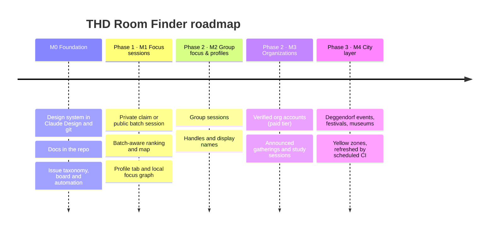

# Project charter

| | |
|---|---|
| **Product** | THD Room Finder: find a free room at THD, and focus in it alone or with your batch |
| **Owner** | Maintainer ([@arudaev](https://github.com/arudaev)) |
| **Decided** | 10 October 2026 (study presence), **revised 13 October 2026 (focus-first)** |
| **Scope authority** | This file. Details: [focus sessions spec](docs/product/focus-sessions.md), [ADR 0001](docs/architecture/adr/0001-study-presence.md), [ADR 0002](docs/architecture/adr/0002-focus-session-lifecycle.md) |

## Why the direction changed

The app in production answers one question well: *where is a free room right
now, and for how long?* Students need that answer intensely around exams,
roughly four months a year, and hardly at all otherwise. New students try it
once, find a good map and stop opening it. A room list alone cannot grow
beyond exam season.

**Phase 1 makes Room Finder a daily focus tool.** About a hundred teaching
rooms stand free for hours on a normal day. They are, in effect, free
co-working spaces. The app helps a student pick one, start a focus session,
and optionally let their batch know where they are.

## Phases

Milestones and epics: [roadmap](docs/product/roadmap.md). Later phases in
detail: [later phases](docs/product/later-phases.md).

## Phase 1 decisions

| # | Decision | Detail |
|---|---|---|
| D1 | **Private is the default** and claims the room anonymously: everyone sees *a focus session* in dark purple, nobody sees who. | ADR 0002 §1 |
| D2 | **Public invites your batch**: same programme + intake sees a violet "AIN 7 · studying" signal and may see a display name; everyone else sees the anonymous claim. | ADR 0002 §1 |
| D3 | A claim is **not a reservation**. THabella lectures always win and end the session. | ADR 0002 §1 |
| D4 | **Locking the phone does not end a session.** Sessions end at the chosen end (default: next lecture, max 3 h), on End, or after a missed 60-minute check-in. | ADR 0002 §2 |
| D5 | **Focus history lives on the device.** The focus graph and the share card are generated locally; the server keeps no completed sessions. | ADR 0002 §3 |
| D6 | Navigation becomes **Campus · Rooms · Profile**. Profile holds the study profile, focus graph, saved rooms and appearance. | [Spec](docs/product/focus-sessions.md#profile-tab-replaces-saved) |
| D7 | **Colour semantics:** teal free, amber closing soon, red lecture, **violet** your focus and your batch, **dark purple** claimed by someone else, **ochre** reserved for Phase 3 events, blue for structure and actions. Colour is never the only signal. | [Spec](docs/product/focus-sessions.md#colour-semantics) |
| D8 | **Ordering:** free (incl. your batch) → closing soon → claimed → lecture, longest-free first within each. Presence only for "now". | ADR 0002 §4 |
| D9 | Batch = programme + intake term, **self-declared**, shown as programme + current semester (AIN 7). | [Spec](docs/product/focus-sessions.md#batches) |
| D10 | Backend: one Supabase project (Auth with email code, Postgres with RLS, small RPC surface). The THabella proxy stays a narrow CORS/cache proxy. | ADR 0001 |

## Scope

| Phase 1 (M1) | Later phases | Never in this project |
|---|---|---|
| Study profile with programme, batch and sharing default | Group sessions, handles, friends-lite (M2) | Replacing myTHD: grades, timetables, university email |
| One focus session per person: private claim or public batch | Verified organization accounts, gatherings (M3) | Booking rooms in THabella, or pretending to |
| Batch- and claim-aware list order and map signals | City events, festivals, museums (M4) | GPS tracking or attendance records |
| Profile tab, local focus graph, share card | Server push, calendar export | Selling or sharing student data |
| Local Supabase stack, isolated preview environment | Additional campuses when there is demand | A general chat or social network |

## Guardrails

- **Accountless still works.** Browsing, search, saved rooms and a local timer
  never require sign-in.
- **The schedule is authoritative.** No social signal hides a lecture or makes
  an occupied room look free.
- **Privacy by construction.** Authorization is enforced by the service (RLS
  and RPC), never by hiding data in the client. No real student data in
  previews; synthetic users only.
- **Costs are bounded before launch.** Hosted activation waits for the
  [pilot checklist](docs/architecture/pilot-verification.md): plan, region,
  budget alerts, request ceilings.
- **Agents propose, the maintainer merges.** No agent merges PRs, enables
  auto-merge, force-pushes shared history or publishes releases.

## Current authorization

Authorized now: documentation, research, design-system work in Claude Design,
issue and project workflows, repository settings, and local or staging
environment setup (including a local Supabase configuration without schema).

Application features, database migrations and hosted Supabase provisioning
start only when the maintainer explicitly asks for a tracked issue to be
implemented. An issue existing on the board does not authorize implementing
it.

## Definition of done for Phase 1

Room → Start focus → private claim visible to others → switch to public →
batchmate sees the invitation → correct list order and map signals →
phone locked for 30 minutes → check-in → End → focus graph updated. This works
on Android (app and browser), iOS Safari and desktop, in English and German,
in light and dark, with list equivalents for every map signal. Privacy is
verified by direct API calls for owner, batchmate, other batch and signed-out
users, and request volume is measured against ADR 0002.
