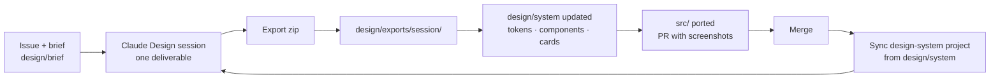

# design/ — where THD Room Finder's design lives

Code is built in Claude Code; design systems, screens and specs are designed in
**Claude Design** (claude.ai/design). This folder is the bridge: everything
that matters in Claude Design is mirrored here, so it is reviewable in pull
requests and versioned with the code that implements it.

```
design/
  README.md            this file: the projects, the loop, the rules
  build-ds-bundle.sh   assembles the upload for the design-system project
  system/              mirror of the design-system project (tokens, components, cards, kits)
  brief/               the Phase 1 design brief; also uploaded into the project
  exports/             session exports as delivered, one folder per session (created per session)
```

## Claude Design projects

| Project | Type | ID | Role |
|---|---|---|---|
| **THD Room Finder Design System** | Design system | `de229b71-7390-4512-805f-a450449acdf8` | **Current.** Tokens, components, guideline cards, UI kits, templates and the brief. Every THD design project attaches it. Mirrored in `system/` ([sync](system/README-SYNC.md)) |
| **THD Room Finder — Focus (Phase 1)** | Design project | listed in [README-SYNC](system/README-SYNC.md) | Runs sessions D1–D4 from [brief/03-sessions.md](brief/03-sessions.md). First message: [brief/00-first-message.md](brief/00-first-message.md) |

**Design system vs. design project vs. Claude project.** A *design system*
project holds the brand: tokens, components and rules. It is attached to other
projects, which see it as `_ds/…` and read it before every task. A *design
project* is where screens are made; it attaches a design system and produces
exports. A *Claude project* (claude.ai Projects) is a chat workspace with
knowledge files; it can hold this brief and the docs for discussion, but it
does not render designs. Claude Code reaches Claude Design through its design
tools: it reads projects, syncs the design system from this folder and picks
up exports.

## The loop



1. **Plan first.** A session has an issue (Phase 1: [#21](https://github.com/arudaev/THD-Room-Finder/issues/21))
   and an entry in [brief/03-sessions.md](brief/03-sessions.md).
2. **One deliverable per session**, ending with an export and a handback note.
3. **Handback** ([brief/04-handback.md](brief/04-handback.md)): the export goes
   into `exports/` untouched; approved pieces are promoted into `system/` and
   ported to `src/` in the same PR.
4. **Sync back:** after merge, the design-system project is synced from
   `system/`. Repo first, project second; never the other way round without a
   PR.

## Rules that never bend

- The schedule wins: no design may make an occupied room look free.
- Tokens only. New colours become tokens with recorded contrast first.
- Material 3: shadows not borders, 16 px cards, pill buttons, Roboto + Roboto Mono.
- English and German for every string; room codes untranslated.
- No real student names or data in mocks; use clearly fake sample data.

See [system/readme.md](system/readme.md) for the full visual foundations and
the focus layer, and the
[focus sessions spec](../docs/product/focus-sessions.md) for behaviour.
