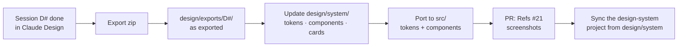

# 04 · Handback

How a finished design session becomes code.



1. **Export** the session from Claude Design (zip with HTML, JSX and assets).
2. **Commit it as-is** to `design/exports/<session>/` on a branch for issue
   [#21](https://github.com/arudaev/THD-Room-Finder/issues/21) (or the
   session's own issue). Exports are a record; never edit them.
3. **Promote what was approved** into `design/system/`: new tokens into
   `tokens/colors.css`, new components with `.jsx`, `.d.ts` and `.prompt.md`,
   cards into `guidelines/`.
4. **Port to the app**: tokens into `src/styles/tokens/`, components into
   `src/components/` as TypeScript, mirroring the design-system props 1:1.
   Once a component lives in the app, the TypeScript is the source:
   `node design/mirror-components.mjs` regenerates its `.jsx` and `.d.ts` in
   `design/system/` (D1–D4 went this way: port first, then mirror, as two
   stacked PRs).
5. **Open a PR** with before/after screenshots in light/dark and EN/DE.
6. **Sync** the Claude Design project from `design/system/` after merge
   (`design/system/README-SYNC.md`).

## Handback note template

Write this at the end of each session, in the export as `HANDBACK.md`:

```markdown
# D1 · Room detail and focus surface — handback

## Decisions
- …

## New or changed tokens
| Token | Light | Dark | Why |

## New or changed components
| Component | Props | States | Notes |

## Copy (EN / DE)
| Key | EN | DE |

## Open questions
- …
```
