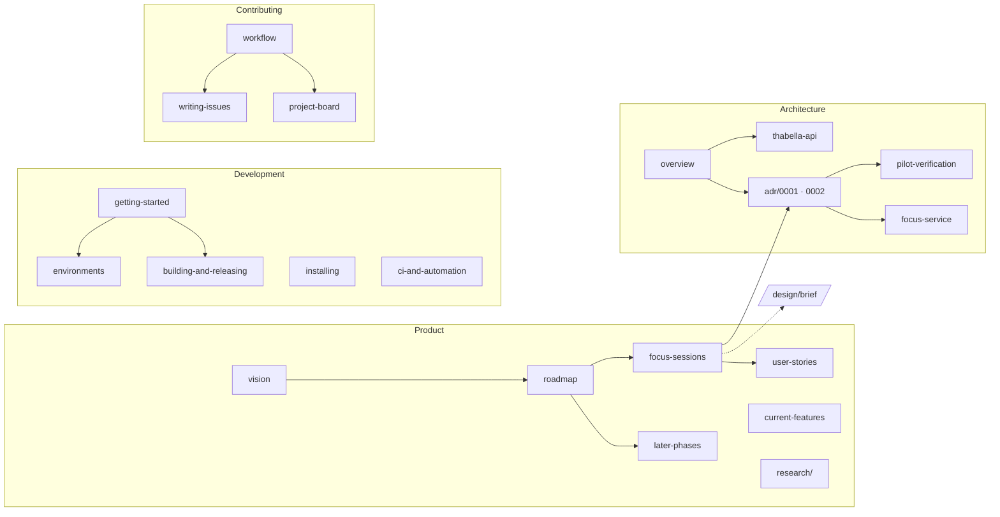

# THD Room Finder documentation

Everything about the product, its architecture and how to work on it. The
documentation lives in this repository, so it changes in the same pull
requests as the code it describes.

## Start here

| I am… | Read |
|---|---|
| A student who wants to use the app | [Installing on a device](development/installing.md) · [Current features](product/current-features.md) |
| A new contributor | [CONTRIBUTING](../CONTRIBUTING.md) → [Getting started](development/getting-started.md) → [Workflow](contributing/workflow.md) |
| A designer | [Design workflow](../design/README.md) → [Design brief](../design/brief/README.md) → [Focus sessions spec](product/focus-sessions.md) |
| Working on Phase 1 | [Charter](../PROJECT-CHARTER.md) → [Focus sessions spec](product/focus-sessions.md) → [ADR 0002](architecture/adr/0002-focus-session-lifecycle.md) → [Environments](development/environments.md) |
| The maintainer | [Roadmap](product/roadmap.md) · [Project board](contributing/project-board.md) · [CI and automation](development/ci-and-automation.md) |

## Map

## Contents

**Product**
- [Vision](product/vision.md): why the app is moving from an exam utility to a daily focus tool
- [Roadmap](product/roadmap.md): phases, milestones, epics and issue order
- [Focus sessions](product/focus-sessions.md): the Phase 1 specification
- [Later phases](product/later-phases.md): group focus, organizations, city layer
- [User stories](product/user-stories.md)
- [Current features](product/current-features.md): what ships today
- [Research](product/research/README.md): dated research snapshots

**Architecture**
- [Overview](architecture/overview.md): layers, data flow, caching, routes
- [THabella API](architecture/thabella-api.md)
- [Focus service](architecture/focus-service.md): the Supabase contract for identities, sessions and room summaries
- [Decision records](architecture/adr/README.md): [0001 study presence](architecture/adr/0001-study-presence.md), [0002 focus lifecycle](architecture/adr/0002-focus-session-lifecycle.md), [0003 share links](architecture/adr/0003-focus-graph-share-links.md)
- [Pilot verification](architecture/pilot-verification.md): operating limits and hosted activation checklist

**Development**
- [Getting started](development/getting-started.md)
- [Environments](development/environments.md): local, preview, production; Supabase locally
- [Building and releasing](development/building-and-releasing.md)
- [Installing on a device](development/installing.md)
- [CI and automation](development/ci-and-automation.md)
- [Security checks](development/security-checks.md): Dependabot and the Supabase advisors

**Contributing**
- [Workflow](contributing/workflow.md)
- [Writing issues](contributing/writing-issues.md)
- [Project board](contributing/project-board.md)

## Conventions for these docs

- Plain Markdown that renders on GitHub; diagrams in Mermaid.
- Relative links between pages; CI checks them.
- Present tense for what exists, future tense plus an issue link for what is
  planned. Research pages carry a date and never describe current behaviour.
