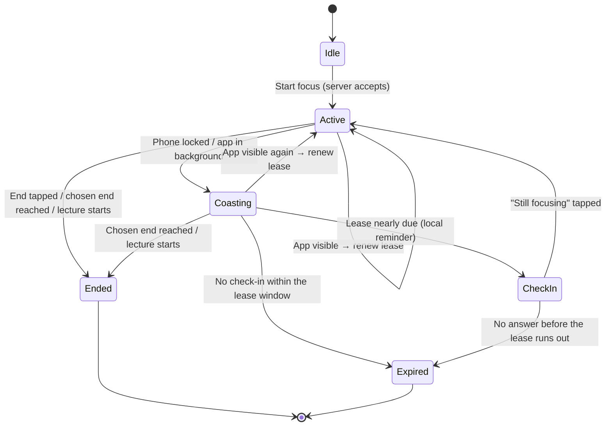
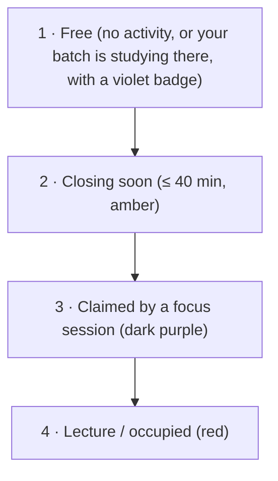

# ADR 0002: focus session lifecycle, sharing modes and local history

| | |
|---|---|
| **Status** | Accepted (direction), values provisional until spike [#39](https://github.com/arudaev/THD-Room-Finder/issues/39) reports |
| **Date** | 13 October 2026 |
| **Decided by** | Maintainer |
| **Amends** | [ADR 0001](0001-study-presence.md): sharing choices, lease and client state, history |
| **Tracks** | [#32](https://github.com/arudaev/THD-Room-Finder/issues/32) (decision), [#19](https://github.com/arudaev/THD-Room-Finder/issues/19) (lifecycle), [#20](https://github.com/arudaev/THD-Room-Finder/issues/20) (ranking), [#38](https://github.com/arudaev/THD-Room-Finder/issues/38) (focus graph) |

## Context

ADR 0001 modelled presence as a short heartbeat: the page renews every 60
seconds while visible, and a hidden page expires the session after five
minutes. It also offered a "private local" mode that publishes nothing, and
kept no history.

The maintainer's Phase 1 direction (charter, 13 October 2026) changes three
assumptions:

1. **Students lock their phones while they study.** A session that ends five
   minutes after the screen turns off ends almost every real session early.
2. **Private should still claim the room.** A student focusing privately wants
   others to see that the room is in use, without learning who is in it.
3. **Students want to see and share their consistency** as a GitHub-style
   focus graph.

## Decision

### 1. Two sharing modes, plus a signed-out timer

| Mode | Who sees what | Default |
|---|---|---|
| **Private** (claim) | Everyone: the room has *a focus session* (dark purple), no name, programme or batch. Owner: full detail. | **Yes** |
| **Public** (batch) | Same programme **and** intake ("AIN 7"): violet *batch studying* signal, optional display name, an invitation to join. Everyone else: the same anonymous claim as Private. | No |
| **Signed-out timer** | Nobody. Runs locally, records to the local focus graph only. | Used when not signed in or offline |

A claim is a **social signal, not a reservation**. THabella lectures always
win: a lecture ends the session and is shown as occupied regardless of focus
activity. A student may switch Private ↔ Public during a session; narrowing
takes effect on the next read, and widening never happens implicitly.

### 2. Duration-bound session with a check-in lease

At start, at server time `s`:

- `plannedEnd = min(s + chosenDuration, nextLectureStart, s + 3 h)`. The
  default `chosenDuration` is "until the next lecture".
- `leaseUntil = min(plannedEnd, s + LEASE)` with **`LEASE` = 60 minutes**
  (provisional).
- Any visible-app activity renews: `leaseUntil = min(plannedEnd, now + LEASE)`,
  at most once per 5 minutes while visible, and immediately when the app
  returns to the foreground.
- The session is live while `now < leaseUntil` and `now < plannedEnd`.
- **Locking the phone does not end the session.** The client stops all
  network activity while hidden; the server lease carries the session.
- Before the lease runs out, the Android app (Capacitor) schedules a local
  notification ("Still in E212? Tap to keep focusing"). The web PWA shows a
  "Still focusing?" prompt when it returns after more than 45 minutes. Web
  push is out of scope for M1.
- Expired sessions cannot be resurrected by a late request. Restarting is a
  new session, in line with ADR 0001's no-resurrection rule.

Unchanged from ADR 0001: one active session per identity, server time only,
idempotent start and end, a single renewing tab per device, and summaries
bounded to visible rooms.

### 3. Focus history stays on the device

Ending or expiring a session appends `{date, minutes, roomCode?}` to
**IndexedDB on the device**. The focus graph and the share card are computed
and rendered locally. The server still stores no completed sessions, so ADR
0001's retention rule holds. Export/import as JSON covers phone changes.

The share card is a PNG of about 1200×630 and at most 150 KB, generated with
`<canvas>` and shared through the Web Share API (download fallback). It
contains the graph, streak and totals only; name, room and programme are
opt-in.

### 4. Ordering and signals

Applied after THabella eligibility and duration rules, duration-first within
each bucket:

Presence is shown for **now** only. Time-travel queries show the schedule
alone. If presence cannot be loaded, ranking falls back to the schedule and
the UI says "activity unknown", never "empty".

## Consequences

**Request volume falls.** With ADR 0001, a 50-minute session cost about 52
operations. With a locked phone and a 60-minute lease it costs a start, an
end and a few renewals when the app is opened: roughly 3–8 operations. The
[pilot verification](../pilot-verification.md) ceilings stay as upper bounds
and are re-measured in [#22](https://github.com/arudaev/THD-Room-Finder/issues/22).

**Claims can be stale for up to one lease window** if a student leaves without
ending the session. Mitigations: the 3-hour cap, lecture-start termination, the
check-in reminder, and a "claimed 40 min ago" age on the claim so seekers can
judge it. A "this room is empty" report from another student is a candidate for
M2, not M1.

**Private still reveals that a room is in use.** That is the point of a claim.
Setup must say so plainly: "Others will see that someone is focusing in this
room, but not who."

**The local focus graph can be lost** with the device or browser data. Export
mitigates this; server sync is a possible later opt-in, not M1.

## Alternatives considered

| Option | Why not |
|---|---|
| Keep ADR 0001's five-minute hidden-page expiry | Ends almost every real session when the phone locks |
| Background keep-alive (wake lock, silent audio, background sync) | Unreliable on iOS, drains battery, and app stores and browsers treat it as abuse |
| No expiry until the chosen end | Forgotten sessions block rooms for hours |
| Server-side focus history | Contradicts ADR 0001 retention; creates attendance records nobody asked for |
| Private = publish nothing | Fails the "the room is taken" use case; the signed-out timer covers fully private study |

## Open values for the spike

| Value | Provisional | Decided by |
|---|---|---|
| `LEASE` | 60 min | #39 device measurements |
| Renew interval while visible | 5 min | #39, cost model |
| Web "still focusing?" threshold | 45 min | Usability check in #22 |
| Max session | 3 h | Charter; revisit after the pilot |
