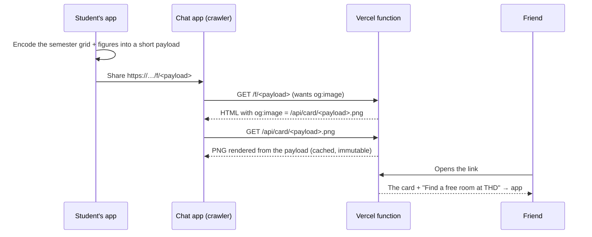

# ADR 0003: focus graph share links with a stateless preview

| | |
|---|---|
| **Status** | Proposed. Format of the preview image pending a platform check (below) |
| **Date** | 14 October 2026 |
| **Decided by** | Maintainer (direction), details open for review |
| **Amends** | [ADR 0002](0002-focus-session-lifecycle.md) §3: how the share card leaves the device |
| **Tracks** | [#38](https://github.com/arudaev/THD-Room-Finder/issues/38) (focus graph and share card) |

## Context

ADR 0002 keeps focus history on the device and shares the focus graph as a
PNG file through the Web Share API. Design session D4 built that card
(1080×1080, the current semester, theme and accent of the sender).

Reviewing D4, the maintainer wants students to share a **link to the app**
whose **social preview is their focus graph**: in WhatsApp, Discord or
LinkedIn the friend sees the card as the link preview, and tapping it opens
THD Room Finder. A plain image reaches the friend but never brings them to
the app.

A link preview needs an image that a crawler can fetch from a public URL.
That seems to require storing the graph on a server, which ADR 0002 and
charter decision D5 rule out.

## Decision

**The link carries the graph; the server stores nothing.**

1. **Payload in the URL.** Share encodes a snapshot: format version,
   semester id, one level (0–4) per day of the current semester (about 26
   weeks × 7 days at 3 bits ≈ 70 bytes), hours and streak, language, theme
   and accent. Display name and batch are added **only** if the student
   switched them on. Base64url keeps the link around 120 characters.
2. **Stateless rendering.** A Vercel function decodes the payload and
   renders the card (`@vercel/og` or an equivalent) as the `og:image`. The
   response is immutable and cached at the edge; the same payload always
   gives the same image. Nothing is written anywhere.
3. **Landing page.** Opening the link shows the card, the figures and one
   call to action into the app. It works without an account.
4. **A snapshot, not a profile.** The link never updates and never expires.
   It is not proof of anything: anyone could craft a payload, the same as
   editing a screenshot.
5. **Save image stays** as a secondary action (the D4 PNG), for Instagram
   stories and apps that drop link previews.
6. **Preview image format** is checked before implementation: render both
   1200×630 and 1080×1080 from one payload and test the preview in
   WhatsApp, Discord, LinkedIn, Telegram and iMessage. Many chat apps show
   1.91:1 images large and square ones as a small thumbnail; the check
   decides.

## Consequences

- **D5 still holds.** The server keeps no completed sessions and no
  per-student record. The sender chooses to publish one snapshot, and the
  data lives in the link they hand out.
- **Request logs see the URL.** Vercel's access logs contain the payload for
  their retention period. The payload has day levels only, no rooms or
  times; a name appears only when the student opted in. The share sheet says
  this in one line.
- **Cost:** one cached render per distinct link; crawler hits after the
  first are CDN hits. Within the Phase 1 budget.
- **The proxy grows by one route.** `api/` gains a card renderer and the
  `/f/*` page. Both are read-only and take no user input beyond the payload,
  which is length-capped and validated.

## Alternatives rejected

| Alternative | Why not |
|---|---|
| Store snapshots server-side, share an id | Contradicts D5; adds retention and deletion duties |
| Image only (ADR 0002 as written) | Never brings the friend to the app; kept as the secondary action |
| A live public profile page | Needs accounts and server history; out of scope until Phase 2 profiles |
