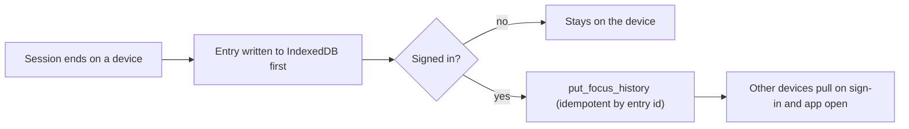

# ADR 0005: focus across a student's devices

| | |
|---|---|
| **Status** | Accepted |
| **Date** | 15 October 2026 |
| **Decided by** | Maintainer |
| **Amends** | [ADR 0002](0002-focus-session-lifecycle.md) §3 (history stays on the device) |
| **Tracks** | [#89](https://github.com/arudaev/THD-Room-Finder/issues/89) (graph sync), [#90](https://github.com/arudaev/THD-Room-Finder/issues/90) (running session across devices) |

## Context

ADR 0002 kept the focus history on the device: the server stores no completed
sessions, and Export/Import covers a phone change. A running session lives in
the starting device's storage only.

Before sharing the app widely, the maintainer signed in on a phone and on a
laptop and expected one student, not two:

1. The focus graph, streak and semester hours should be the same on both.
2. A session started on the phone should show on the laptop, and either
   device should be able to start the next block or end it.

Students who never sign in must keep the device-only behaviour of
[ADR 0004](0004-focus-rhythm.md) §4.

## Decision

### 1. Signed-in history syncs; signed-out history stays on the device

| Synced per entry | Never synced |
|---|---|
| Entry id, start, end, focus minutes | Room code, breaks, away time, batch, rhythm |

- **Union by entry id.** Uploads and imports never double count; a device
  that signs in uploads what it already has, then downloads the rest.
- **Offline first.** The entry is written locally before any upload; a
  failed upload is retried on the next app open.
- **Owner only.** `focus.history` sits in the private schema with RLS and no
  policies; three `SECURITY DEFINER` functions read, add and clear the
  caller's own rows. No batch, programme or other user can read them.
- **Retention.** Kept until the student clears the history or deletes the
  account (`on delete cascade`). Clearing on one device clears the account
  copy; other devices keep their local copy until they clear it too.
- **Signing out** keeps the local copy and stops syncing.
- **Cost.** One upload per finished session; one download per sign-in or app
  open, of rows added since the last one. At most 500 entries per call and
  5,000 per student.

### 2. A running shared session follows the student

- On app open, a signed-in device without a session of its own reads
  `get_focus` and **adopts** a live session: room, rhythm, anchor, planned
  end and visibility. Breaks and blocks line up because both devices lay the
  plan out from the same anchor.
- The adopted session counts from the current block: a block that was
  already running is treated as confirmed, and a block waiting for an answer
  asks again on this device.
- **One entry per session.** A shared session's history entry uses the
  server session id, so when both devices record it, the account keeps the
  first upload and each device keeps one entry for it.
- **Moving rooms asks first.** Starting in another room while the server
  holds a session this device doesn't know about returns `already_active`;
  the app asks "Move your session here?" instead of replacing it silently.
- **Notifications** stay on the device that started the session. A device
  that adopted it stays quiet until a block is confirmed on it, so a laptop
  doesn't ring next to the phone.
- **The owner's session JSON** gains `room_code` and `renewed_at`
  (migration `20261015170000_focus_session_handoff.sql`); blocks that began
  before the last renewal count as confirmed on the adopting device.
- Device-only sessions (no study profile, offline, unknown room) never leave
  their device.

## Consequences

**The server now keeps completed focus time** for signed-in students: dates
and minutes, no rooms. The privacy copy in Settings and on the website says
so, and the service header comment in the first migration is superseded by
this ADR.

**Two devices may disagree for a moment**: a device that missed the last
confirmation shows the "Start block" prompt until the next renew. That is
the same prompt the student answers anyway.

**Nothing changes without an account**, and production keeps device-only
focus until the hosted service is activated
([#17](https://github.com/arudaev/THD-Room-Finder/issues/17)).

## Alternatives considered

| Option | Why not |
|---|---|
| Sync daily totals instead of entries | Merging totals from two devices double counts; entries merge by id |
| Sync room codes too | Not needed for the graph, and a room history is more sensitive than minutes |
| Realtime push between devices | Another channel to run and pay for; adopting on app open covers the case |
| Keep Export/Import only | The maintainer's own phone/laptop test showed it is not enough to share the app |
