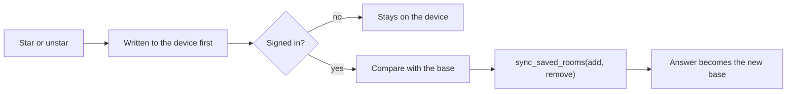
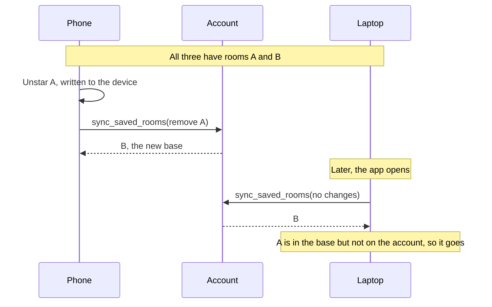
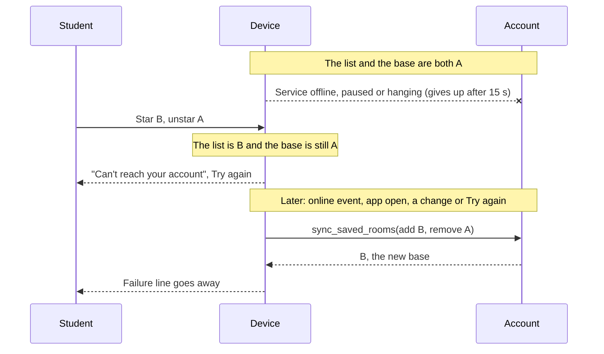
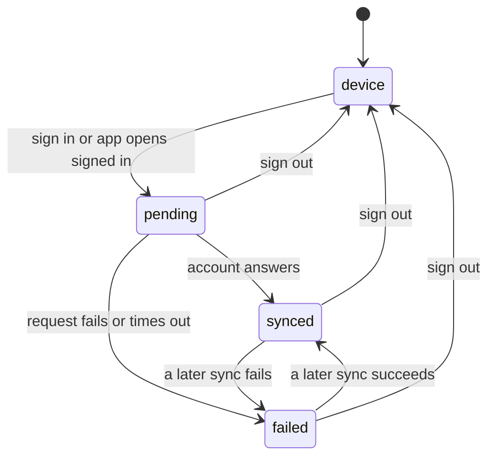

# ADR 0013: saved rooms across a student's devices

| | |
|---|---|
| **Status** | Accepted |
| **Date** | 9 November 2026 |
| **Decided by** | Maintainer |
| **Amends** | [ADR 0001](0001-study-presence.md) ("favorites remain local") |

## Context

Saved rooms have lived in the device's localStorage since v2. A student who
signs in on a phone and a laptop expects one list, as they already get one
focus graph ([ADR 0005](0005-focus-across-devices.md)). The charter still
holds: saved rooms never require an account.

## Decision

Signed out, nothing changes. Signed in, the list syncs with the account.

**The account stores identifiers only.** `focus.saved_room` has two columns,
owner and room identifier. No timestamps and no record of removals, so the
server can't tell when a student saved or stopped saving a room.

**Each device keeps a base**: the last list it agreed on with the account.
What changed since the base is what the device sends, and a three-way merge
(`src/domain/savedRooms.ts`) tells the two kinds of missing room apart:

| The room is… | Meaning | Result |
|---|---|---|
| on the device, not in the base | added here | sent to the account |
| in the base, not on the device | removed here | removed from the account |
| in the base, not on the account | removed elsewhere | removed here |
| on the account, not in the base | added elsewhere | added here |

- **First sign-in on a device.** The base is empty, so the merge is the union
  and nothing is lost.
- **Signing out** keeps the list on the device and keeps the base, so a later
  sign-in on the same account still recognises removals, including ones made
  while signed out. Deleting the account forgets the base.
- **Offline, paused or hanging.** The list works from the device. The
  difference from the base is the outbox, so there is no queue to lose;
  requests give up after 15 s. Profile says the account can't be reached and
  offers *Try again*. A sync also runs on app open, on the `online` event, on
  return to the app (at most once a minute) and after each change.
- **Unknown is not empty.** An unreadable device list drops the base, so it
  can't be read as "every room removed"; a malformed server answer fails the
  sync instead of clearing the list.
- **Owner only.** RLS on, no policies, schema not exposed; one `SECURITY
  DEFINER` function takes the user from `auth.uid()`. Rows go with the account
  (`on delete cascade`).
- **Cost.** One call per change and per app open, and no realtime channel. At
  most 1,000 rooms per call and per student, far above the campus room count.

### How a removal reaches another device

Neither device stores that the room was removed. The laptop works it out: the
room is in its base and no longer on the account.

### Failing and catching up

A failed request sends nothing and loses nothing. The list and the base stay
as they were, so the next sync sends the same difference.

The list on Profile shows one of four sync states. None of them is a spinner:
the student's list is on screen in all four.

| State | What Profile says |
|---|---|
| `device` | Nothing about syncing |
| `pending` | Nothing yet |
| `synced` | "On every device you sign in on." |
| `failed` | "Can't reach your account right now…" with *Try again* |

## Consequences

**The server now knows which rooms a signed-in student saved.** It is a list
without times, not an attendance record ([charter](../../../PROJECT-CHARTER.md)),
and focus history still never holds rooms (ADR 0005).

**Unstarring while signed out reaches the account.** The room is in the base
and not on the device, so the next sign-in on that account removes it there
too. The student removed it on purpose, and bringing it back would break the
rule that removals stick.

**Another device updates when it next opens or returns to the app**, not
instantly.

**A shared device mixes lists.** The list stays on the device after sign-out,
so the next person to sign in there merges it into their account. This
follows from never losing either side, and a room list is low stakes.

**Order is per device.** The account holds a set; rooms new to a device go at
the end of its list.

## Alternatives considered

| Option | Why not |
|---|---|
| Plain union on every sync | Removed rooms come back from any device that still has them |
| Server tombstones with timestamps | Stores when a room was dropped, and trusts device clocks to order changes |
| Replace the list with the last writer's | Two devices overwrite each other; offline changes are lost |
| Realtime push | Another channel to run and pay for, as in ADR 0005 |
