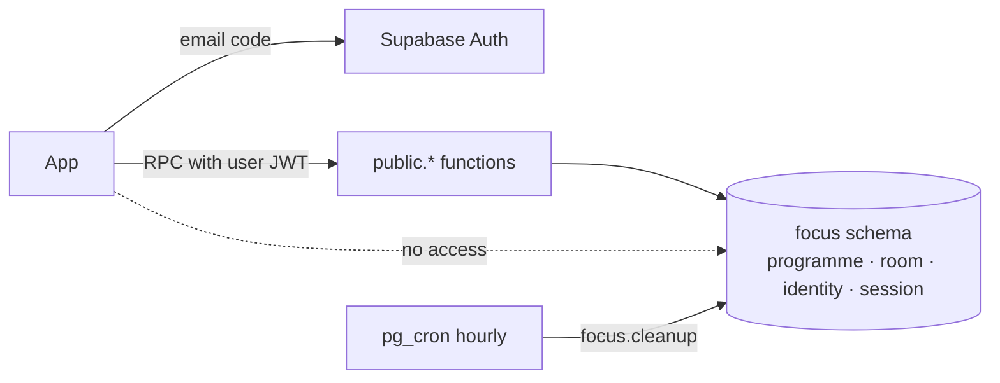

# Focus service contract

> **Status:** implemented locally for
> [#17](https://github.com/arudaev/THD-Room-Finder/issues/17)
> (`supabase/migrations/20261014190000_focus_service.sql`). Hosted activation
> stays gated by the [pilot checklist](pilot-verification.md). Decisions:
> [ADR 0001](adr/0001-study-presence.md) (identity, access, retention) and
> [ADR 0002](adr/0002-focus-session-lifecycle.md) (Private / Public, lease).

The service is one small Supabase project: Auth for an email code sign-in and
Postgres for study identities, running sessions and, for signed-in students,
the focus history ([ADR 0005](adr/0005-focus-across-devices.md)). The app
calls a handful of database functions over the Data API; it never touches a
table. Everything else stays on the device: favourites, room codes in the
focus history and the signed-out timer.



## Boundary

| Rule | How it is kept |
|---|---|
| No direct table access | Tables live in schema `focus`, which the Data API does not expose; RLS is on with no policies as a second lock |
| Identity comes from the token | Every function calls `auth.uid()`; none accepts a user, batch or viewer from the caller |
| Definer functions are tight | `security definer`, `search_path = ''`, schema-qualified names, `execute` granted per function |
| Signed out sees anonymous claims only | `anon` may call `list_programmes` and `room_summaries`, nothing else |
| No history on the server | Ended sessions are deleted 24 hours later by `focus.cleanup` (hourly) |
| No secrets in the app | The browser gets the publishable key only; the service-role key is never used by the app |

## Data

| Table | Holds | Notes |
|---|---|---|
| `focus.programme` | Programme catalogue: id, code, EN/DE name, intake terms, active | Ids are stable slugs; the real list comes from the taxonomy in [#40](https://github.com/arudaev/THD-Room-Finder/issues/40), not built yet. Only listed, active programmes can share Public |
| `focus.room` | Rooms a session may name: `thd:<THabella ident>`, campus, code, active | Generated from THabella by `scripts/dev/focus-rooms-sql.py` as a migration; students cannot add rooms |
| `focus.identity` | Display name (1–32), programme, intake year + term, default visibility, show-name consent, version | Self-declared. Batch = programme + intake year + intake term. No email |
| `focus.history` | Owner, entry id, start, end, focus minutes, synced at | Signed-in students only ([ADR 0005](adr/0005-focus-across-devices.md)). No room, rhythm or batch. Primary key (owner, entry id); at most 5,000 per owner; deleted with the account |
| `focus.session` | Owner, room, visibility, show-name, batch snapshot, request id, started, planned end, lease, ended + reason, version, rhythm (focus, break, long break, every) and anchor | One open session per person (unique partial index). Planned end ≤ 3 h after start; lease ≤ planned end; anchor ≤ 3 h before start |

A session is **live** while `ended_at is null`, `now() < lease_until` and
`now() < planned_end`. The lease is one block, the longer break and
10 minutes to confirm the next block: 70 minutes for Deep 50/10
([ADR 0004](adr/0004-focus-rhythm.md)). A claim needs a study profile;
without one, focus stays on the device and never calls this service.

## Functions

All take named arguments (PostgREST `POST /rest/v1/rpc/<name>`). Session and
identity results are JSON objects; times are server time.

| Function | Who | Does |
|---|---|---|
| `list_programmes()` | anyone | Active programmes for setup |
| `get_identity()` | signed in | Own identity or `null` |
| `save_identity(display_name, programme_id, intake_year, intake_term, default_visibility, show_name, expected_version)` | signed in | Create (version `null`) or update. A new programme or intake **ends the running session** first |
| `get_focus()` | signed in | Own open session or `null`; closes it first if its lease ran out. Owner results carry `room_code` and `renewed_at`, so another device of the same student can pick the session up ([ADR 0005](adr/0005-focus-across-devices.md)) |
| `start_focus(room_key, planned_minutes, visibility, show_name, request_id, replace = false, focus_minutes = 60, break_minutes = 0, long_break_minutes = 0, long_every = 0, anchor_at = now)` | study profile | Starts a session. 1–180 minutes; the client lays out the rhythm until the next lecture. Blocks 5–120 minutes, breaks 0–30; the anchor is now, or a batch session's anchor when joining (at most 3 h ago). Same `request_id` returns the same session. A running session elsewhere is a conflict unless `replace` is true, which ends it. No study profile: `needs_profile` |
| `renew_focus(session_id, expected_version)` | owner | Lease = `min(planned_end, now + focus + break + 10 min)`; called at each confirmed block and while the app is open. Renewals within a minute return without a write. Never revives an ended or expired session |
| `update_focus(session_id, visibility, show_name, expected_version)` | owner | Private ↔ Public and name consent; applies to the next summary read |
| `end_focus(session_id)` | owner | Ends it. Calling again returns the ended session |
| `room_summaries(campus)` | anyone | One row per room **with live activity** on that campus (≤ 500), see below |
| `delete_identity()` | signed in | Ends sessions, then deletes the account and its synced history; the device's copy of the focus graph is untouched |
| `put_focus_history(entries)` | signed in | Adds up to 500 `{id, started_at, ended_at, minutes}` entries; ids already stored and malformed entries are skipped. Returns how many were new. Full at 5,000: `history_full` |
| `get_focus_history(since = null)` | signed in | `{server_now, entries}`: own entries stored after `since`, oldest first |
| `clear_focus_history()` | signed in | Deletes own synced history; returns how many entries went |

### What a viewer sees

`room_summaries` returns `room_key`, `claims`, `claim_since`, `batch_count`,
`batch_since`, `batch_names`, `batch_rhythm`, `own`, `expires_at` and
`server_now`. No user ids. `batch_rhythm` is the rhythm and anchor of the
earliest Public session of the viewer's batch, so Join can line up with it;
everyone else gets `null`.

| Session | Owner | Same batch (signed in) | Everyone else (incl. signed out) |
|---|---|---|---|
| Private | `own` | counted in `claims` | counted in `claims` |
| Public | `own` | counted in `batch_count`; name in `batch_names` only if the owner chose Show my name | counted in `claims` |

Rows appear only for rooms with activity; any room not returned has none. The
quiet preference ("show my batch's sessions like anyone else's") is applied in
the app by treating `batch_count` as claims.

### Errors

Errors carry a stable `hint` for the app to branch on; `message` is for logs.

| `hint` | SQLSTATE | When |
|---|---|---|
| `not_signed_in` | 28000 | A signed-in function without a user |
| `invalid_duration`, `invalid_rhythm`, `invalid_visibility`, `invalid_request`, `unknown_room` | 22023 | Bad input |
| `invalid_programme`, `public_needs_batch`, `needs_profile` | 22023 | Unknown programme or intake; Public without a listed programme; a claim without a study profile |
| `already_active` | 23505 | A session is running and `replace` was not set |
| `stale_version` | 40001 | The record changed elsewhere; reload and retry |
| `not_active` | P0002 | Renew or update on a session that has ended or expired |
| `rate_limited` | 53400 | More than 20 starts in an hour |
| `invalid_history`, `too_many_entries` | 22023 | History upload that is not an array, or over 500 entries |
| `history_full` | 53400 | 5,000 synced entries already stored |

## Not in this contract yet

| Item | Where it goes |
|---|---|
| Per-device lease token (one renewing tab) | ADR 0001 asks for it; the version check covers stale writers for now. Revisit in [#19](https://github.com/arudaev/THD-Room-Finder/issues/19) |
| Separate admission budget table | A per-user start limit (20 per hour) stands in until [#22](https://github.com/arudaev/THD-Room-Finder/issues/22) measures load |
| Full programme list | Once the [#40](https://github.com/arudaev/THD-Room-Finder/issues/40) taxonomy exists; a maintainer import fills `focus.programme` |
| Client wrapper | Identity and sign-in: `src/data/identityApi.ts` ([#18](https://github.com/arudaev/THD-Room-Finder/issues/18)). Sessions: [#19](https://github.com/arudaev/THD-Room-Finder/issues/19) |
| Manual semester correction (leave semesters) | Needs a stored offset on `focus.identity`; today the number follows the intake only |

## Testing

`supabase/tests/database/focus_service.test.sql` (pgTAP) acts as each seeded
person with their own JWT and checks what they can reach and see: no table
access, the audience table above, the 3-hour cap, idempotent start and end,
the replace conflict, stale versions, expiry without revival, Public without a
programme, batch changes ending a session, and account deletion. The
**Database** workflow runs it on every PR that touches `supabase/`, and checks
that the generated types are current.

```bash
npx supabase db reset   # migrations + seed
npx supabase test db    # contract tests
npx supabase gen types typescript --local --schema public   # after a migration
```
