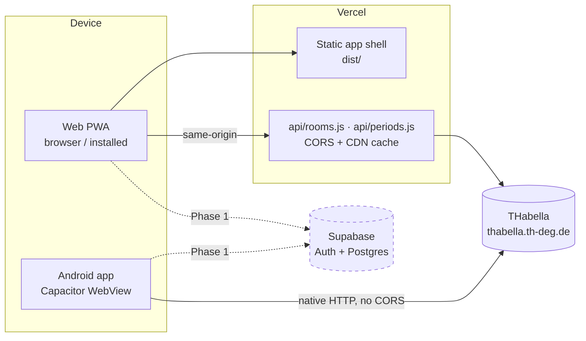
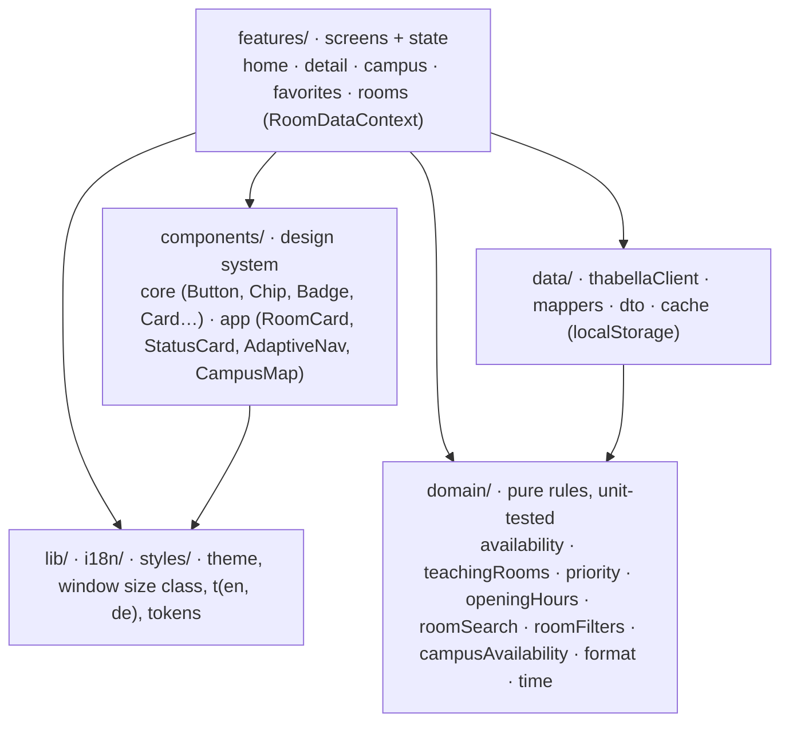
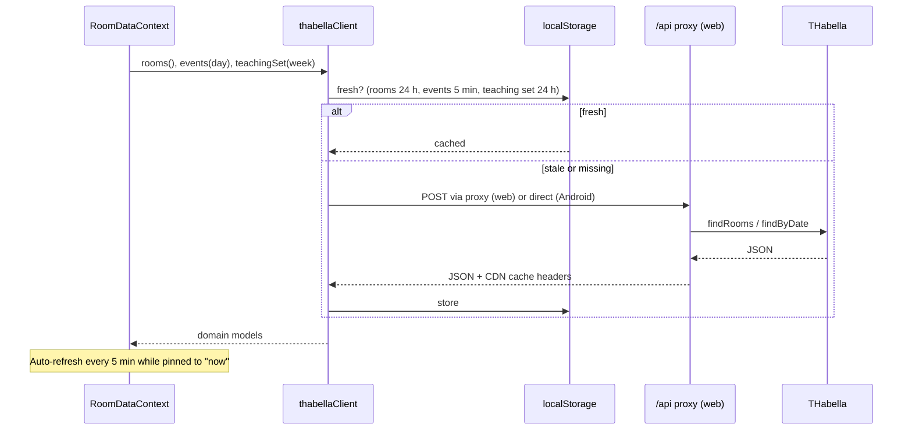

# Architecture overview

THD Room Finder v2 is **one React + TypeScript application** built with Vite.
It ships as an installable PWA on the web (Vercel) and as an Android app
through Capacitor. The v1 native Android/iOS apps are preserved under the
`v1-native` git tag.

## System context

Dashed: the focus service planned in Phase 1 ([ADR 0001](adr/0001-study-presence.md),
[ADR 0002](adr/0002-focus-session-lifecycle.md)). Nothing in production talks
to Supabase yet.

## Layers

Dependencies point inward. The domain layer imports nothing from React or the
network.

| Folder | Responsibility | Rule |
|---|---|---|
| `src/domain/` | Availability, duration, three-state status, teaching-room eligibility, venue exclusions, opening hours, search and filters | No framework imports; every change needs a Vitest test |
| `src/data/` | THabella requests, defensive DTO mapping, localStorage cache with stale fallback | All DTO fields nullable; unknown keys ignored |
| `src/components/` | Design-system components, ported from the [Claude Design system](../../design/README.md) | Tokens only, no literal colours |
| `src/features/` | Screens and React context (`RoomDataProvider`, favorites, filters) | |
| `src/app/` | `AppShell`: routing and adaptive navigation | |
| `src/i18n/`, `src/lib/` | `t(en, de)`, theme provider, window size class | |
| `api/` | Vercel functions proxying THabella with CDN caching | Stays a narrow proxy; never a general backend |

## Routes

| Path | Screen | Phase 1 change |
|---|---|---|
| `/` | Campus map | Batch markers and claim dots |
| `/rooms` | Room list | Focus buckets and badges |
| `/room/:ident` | Room detail | Start focus, focus surface |
| `/saved` | Saved rooms | Moves to `/profile`; `/saved` redirects |

## Data flow and caching

On network failure the client falls back to stale cached data. The proxy
caches rooms for 24 h and periods for 5 min at the CDN edge
(`s-maxage` plus `stale-while-revalidate`).

## The teaching-room filter

THabella lists about 290 rooms, including offices, labs and sports halls. A
room appears in the app only if it hosts at least one event in the current
Monday to Friday week (`domain/teachingRooms.ts`) and is not on the excluded
venue list (`domain/priority.ts`). The set is built from a week of
`findByDate` calls and cached for 24 hours.

## Phase 1 additions

| Piece | Where | Status |
|---|---|---|
| Supabase Auth (email code), Postgres + RLS, RPCs | `supabase/` (local config), hosted project later | Local configuration and schema in [#17](https://github.com/arudaev/THD-Room-Finder/issues/17) |
| Focus domain rules (lease, buckets, batch derivation) | `src/domain/focus*.ts`, `src/domain/cohort*.ts` | Planned, [#18](https://github.com/arudaev/THD-Room-Finder/issues/18)–[#20](https://github.com/arudaev/THD-Room-Finder/issues/20) |
| Local focus history | IndexedDB on the device | Planned, [#38](https://github.com/arudaev/THD-Room-Finder/issues/38) |
| Profile feature | `src/features/profile/` | Planned, [#37](https://github.com/arudaev/THD-Room-Finder/issues/37) |

See [environments](../development/environments.md) for how local, preview and
production are kept apart.
