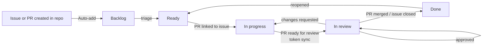

# Project board

[**THD Room Finder — Campus Study**](https://github.com/users/arudaev/projects/8)
is the single place to see what is planned, in progress and done. It
contains every issue and PR of this repository.

## Fields

| Field | Values | Set by |
|---|---|---|
| Status | Backlog · Ready · In progress · In review · Blocked · Done | Automation, triage |
| Priority | P0 blocks the milestone · P1 needed · P2 nice to have | Triage |
| Phase | Foundation · Phase 1 · Focus · Phase 2 · Community · Phase 3 · City | Triage |
| Size | XS < 2 h · S half a day · M 1–2 days · L 3–5 days · XL split it | Triage or assignee |
| Milestone, Labels, Assignees, Parent issue, Sub-issues progress, Linked pull requests, Reviewers | Native GitHub data | GitHub |
| Start date | First day in progress | Token sync (or manual) |
| Target date | Only when there is a real deadline | Maintainer |
| Completed date | Merge or acceptance day | Token sync (or manual) |

## Views

| # | View | Layout | Filter | Grouped / sorted | Use it to… |
|---|---|---|---|---|---|
| 1 | **Board** | Board by Status | `is:open` | Swimlanes off | See flow across statuses |
| 2 | **Open work** | Table | `is:open -label:type:epic` | Group: Status · Sort: Priority | Pick what to do next |
| 3 | **Epics** | Table | `label:type:epic` | Sort: Phase | See milestone progress (Sub-issues progress) |
| 4 | **Milestones** | Table | `is:issue` | Group: Milestone | See everything per milestone |
| 5 | **Roadmap** | Roadmap | `is:issue` | Group: Phase · Dates: Start / Target | Timeline once dates exist |
| 6 | **Pull requests** | Table | `is:pr` | Group: Status | Review queue |
| 7 | **Waiting & blocked** | Table | `status:Blocked` | Sort: Priority | Unblock work |
| 8 | **Done** | Table | `status:Done` | Sort: Updated, newest first | Changelog material |
| 9 | **My work** | Table | `assignee:@me is:open` | Group: Status | Your queue |

## Automation

| Trigger | Result | Mechanism | Active |
|---|---|---|---|
| Issue or PR created in the repository | Added to the board | Built-in *Auto-add to project* | Yes |
| Sub-issue added to a board item | Added to the board | Built-in *Auto-add sub-issues* | Yes |
| Item added | Status → Backlog | Built-in *Item added to project* | Yes |
| PR linked to an issue | Issue → In progress | Built-in *Pull request linked to issue* | Yes |
| Review requests changes | → In progress | Built-in *Code changes requested* | Yes |
| Review approves | → In review | Built-in *Code review approved* | Yes |
| Issue closed / PR merged | → Done | Built-in *Item closed*, *Pull request merged* | Yes |
| Issue reopened | → Ready | Built-in *Item reopened* | Yes |
| Done items untouched for 2 weeks | Archived | Built-in *Auto-archive items* | Yes |
| Moving a card to Done | Does **not** close the issue | Built-in *Auto-close issue* deliberately off | Off |
| Draft PR ↔ ready for review | Issue In progress ↔ In review | `project-sync.yml` | After [#26](https://github.com/arudaev/THD-Room-Finder/issues/26) |
| First In progress / merge | Start date / Completed date | `project-sync.yml` | After #26 |
| PR opened | PR and closed issues assigned to the author | `pr-conventions.yml` | Yes |
| `/take`, `/drop` | Assign or unassign the commenter | `issue-commands.yml` | Yes |
| Last sub-issue closed | Parent labelled `ready-for-acceptance` | `sub-issue-rollup.yml` | Yes |

### Still manual

- **Ready** and **Blocked** are judgement calls, set at triage.
- **Phase, Priority, Size** on new issues.
- Closing an **epic** after its completion criteria are checked end to end.
- Moving a parent to **In review** when it gets `ready-for-acceptance`.
