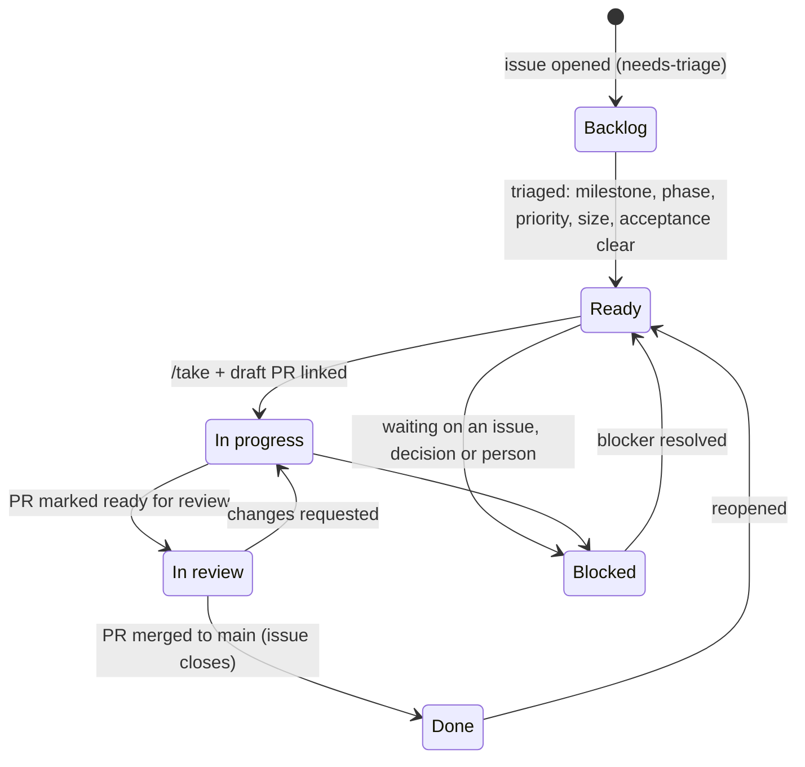

# Workflow

## Issue lifecycle



| Status | Meaning | Who moves it |
|---|---|---|
| **Backlog** | Captured; not yet refined | Automatic when added |
| **Ready** | Scope and acceptance clear; anyone may `/take` it | Maintainer at triage |
| **In progress** | Assigned, draft PR open | Automatic when a PR is linked |
| **In review** | PR ready for review, or an epic awaiting acceptance | Automatic on approval; token sync on "ready for review" |
| **Blocked** | Waiting on another issue (native *blocked by*), a decision or an outside party | Maintainer or assignee |
| **Done** | Merged to `main` or accepted | Automatic when closed or merged |

Details of every automation: [project board](project-board.md).

## Claiming work

- Comment **`/take`** on an open issue. The bot assigns you if the issue is not
  an epic, not taken and not blocked by an open issue, and replies with a
  branch name.
- Comment **`/drop`** if you cannot continue. No hard feelings.
- Working on something for more than a week without a PR? Post a short status
  comment, or `/drop` so someone else can pick it up. The maintainer may
  unassign issues that have been silent for two weeks.
- Maintainers and collaborators can also assign directly.

## Branches

| Prefix | For | Example |
|---|---|---|
| `feature/` | Stories | `feature/19-focus-lifecycle` |
| `fix/` | Bugs | `fix/52-claimed-room-order` |
| `docs/` | Documentation | `docs/33-documentation` |
| `chore/` | Tasks, spikes, tooling | `chore/40-programme-taxonomy` |

Branch from `main` (or from the layer below, in a stack). Branches are deleted
automatically after merge.

## Commits and pull requests

- **PR title = the merge commit's title.** Conventional Commits, at most 72
  characters, imperative, no trailing period: `feat(focus): end sessions when a lecture starts`.
  Types: `feat`, `fix`, `docs`, `refactor`, `test`, `chore`, `ci`, `perf`,
  `build`, `revert`. CI checks it.
- **PR body links its issue**: `Closes #19` for the issue it completes,
  `Refs #16` for context. CI checks it. Never put `Closes` on an epic.
- **Commits inside the PR land on `main` unchanged** (merge commits, not
  squash), so each one counts on your contribution graph. Write them as
  Conventional Commits too, keep them meaningful, and tidy up `wip`/`fix typo`
  commits on your own branch before review. Do not rewrite history others
  have built on.
- **Draft early.** A draft PR shows that work has started and gives you a
  Vercel preview.
- **Ready for review** means: acceptance criteria met, checks green, preview
  checked, screenshots for UI changes.

## Review

- The maintainer reviews every PR. Expect a first response within
  a few days.
- Reviews look at behaviour against the acceptance criteria, tests on domain
  rules, tokens and `t(en, de)` use, privacy, and request cost.
- Resolve conversations or reply to them; push fixes to the same branch.
- The maintainer merges with a **merge commit**. Read the history of `main`
  PR by PR with `git log --first-parent`. Agents never merge.

## Stacked pull requests

Use a stack when issue B genuinely builds on unmerged issue A, as in the
Phase 1 backend chain. Each layer is one branch, one PR and one issue; layer 2
targets layer 1, and so on. GitHub's native stacks are supported by the
official `gh stack` extension.

```bash
gh extension install github/gh-stack     # once
gh stack init feature/17-focus-service-local
# work, commit
gh stack add feature/18-study-profile
# work, commit
gh stack submit                           # opens one draft PR per layer
gh stack view
```

- Close only the layer's own issue in each PR.
- CI runs on every layer, whatever its base.
- Each layer's Vercel preview contains its ancestors.
- After a lower layer merges, `gh stack rebase` restacks the rest. Only the
  branch owner force-pushes their own branches; never force-push someone
  else's.
- Independent work stays independent. Do not stack unrelated issues.

## Forks and licensing

The project is GPL-3.0. Forks, modifications and redistributions are allowed
under the license's terms: keep the license and notices, and provide source
for what you distribute. Contributing upstream is encouraged because it
reaches every THD student with one maintained app. Fork contributors open
ordinary PRs from their fork; native stacks need branches in this repository,
so ask for collaborator access if you plan stacked work.

## AI-assisted contributions

Using AI tools is fine. You are responsible for every line you submit: run it,
test it, and understand it. Do not add AI co-author trailers or "generated
with" lines. Agent rules for this repository are in [AGENTS.md](../../AGENTS.md).
