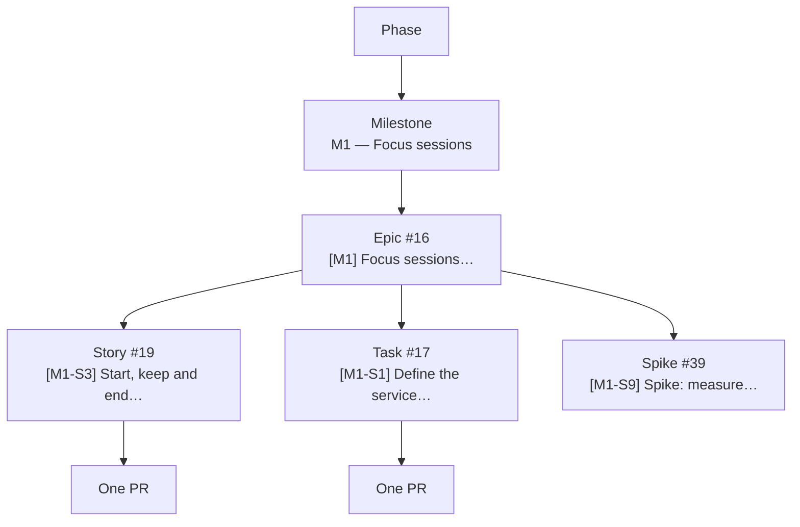

# Writing issues

Every piece of work is an issue. Issues use forms (*New issue* → pick a type);
blank issues are disabled. Questions and loose ideas go to
[Discussions](https://github.com/arudaev/THD-Room-Finder/discussions) first.

## Hierarchy

- A **phase** groups milestones (board field *Phase*).
- A **milestone** has exactly one **epic**.
- An epic owns its children as **native sub-issues** (Relationships panel →
  *Add sub-issue*), not as checklists.
- Each child is delivered by **one PR**. Too big for one PR? Split the child.
- Dependencies use native **blocked by** relationships. They are separate from
  parent/child: S3 can be blocked by S2 while both belong to the same epic.

## Types

| Type | Label | Title | Delivered by | Use when |
|---|---|---|---|---|
| Epic | `type:epic` | `[M1] Outcome in plain words` | Its sub-issues | A milestone outcome; created by maintainers |
| Story | `type:story` | `[M1-S7] Imperative user-visible behaviour` | One PR | Users notice the change |
| Task | `type:task` | `[M0-S4] Imperative technical outcome` | One PR | Infrastructure, tooling, refactoring, docs |
| Spike | `type:spike` | `[M1-S9] Spike: the question` | A doc, ADR or data file | Research with a time box that ends in a decision |
| Bug | `type:bug` | `Bug: what is wrong` | One PR | Something broken; numbered at triage if it belongs to a milestone |

Child numbers (`S1`, `S2`, …) are assigned in creation order within a
milestone and never reused.

## What good looks like

**Story**

> **[M1-S3] Start, keep and end a focus session (private by default)**
>
> *User story:* As a student in a free room, I press Start focus once and the
> session keeps running while my phone is locked, until I end it, it reaches
> the end I chose, or I stop checking in.
>
> *Acceptance criteria:*
> - [ ] Default end = start of the room's next lecture, capped at 3 h.
> - [ ] Locking the phone does not end the session; 60 min without check-in expires it.
> - [ ] A lecture starting in the room ends the session.
>
> *Verification:* domain tests for lease boundaries; device checks on Android and iOS.

Checklist for every issue:

- One outcome, stated from the user's or maintainer's point of view.
- Acceptance criteria someone else can verify without asking you.
- Failure and empty states named (offline, presence unavailable, no batch set).
- Privacy and cost implications stated when data leaves the device.
- Links to the spec, ADR or design session it depends on.

## Labels

| Group | Labels | Rule |
|---|---|---|
| Type | `type:epic` `type:story` `type:task` `type:spike` `type:bug` | Exactly one |
| Area | `area:focus` `area:identity` `area:rooms` `area:maps` `area:data` `area:design-system` `area:docs` `area:delivery` `area:android` `area:community` `area:city` | One or more; PR labels are added from changed paths |
| Workflow | `needs-triage` `needs-design` `needs-decision` `ready-for-acceptance` | Temporary states |
| Community | `good first issue` `help wanted` | Set by maintainers |
| Other | `dependencies` `no-issue` `duplicate` `wontfix` | |

Status, priority, phase and size are **board fields**, not labels.

## Triage (maintainers)

New issues arrive with `needs-triage` in **Backlog**. Triage sets:

1. Type label (fix it if the reporter picked the wrong form).
2. Milestone, and parent epic as a native sub-issue.
3. Board fields: Phase, Priority (P0 blocks the milestone, P1 needed, P2 nice
   to have), Size (XS < 2 h · S half a day · M 1–2 days · L 3–5 days · XL
   split it).
4. *Blocked by* relationships.
5. Remove `needs-triage`; move to **Ready** when the acceptance criteria are
   clear. Add `good first issue` where it fits.

Close as *not planned* with a one-line reason when an idea does not fit the
[charter](../../PROJECT-CHARTER.md).
