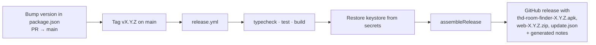

# Building and releasing

## Web

Vercel builds every push: `npm run build` → `dist/` plus the functions in
`api/` (region `fra1`). Each PR gets its own preview URL in the PR checks.
`main` is production at <https://thd-room-finder.vercel.app>. Configuration:
`vercel.json` (SPA rewrites, cache headers for the service worker, assets and
API).

The marketing page in `website/` deploys to GitHub Pages from `main`
(`pages.yml`).

## Android (Capacitor)

Requires JDK 21 and the Android SDK (compile/target SDK 34, minimum SDK 22).
Android Studio bundles a suitable JDK under `jbr/`.

```bash
npm run build
npx cap sync android
cd android
./gradlew assembleDebug        # → app/build/outputs/apk/debug/app-debug.apk
```

Open the native project in Android Studio with `npm run cap:open`.

On Android the app calls THabella directly through Capacitor's native HTTP,
so it does not need the `api/` proxy.

### Signed release APK locally

```bash
cp android/keystore.properties.example android/keystore.properties
# fill in storePassword, keyAlias, keyPassword
# keep release.keystore at the repository root (gitignored)
npm run build && npx cap sync android
cd android && ./gradlew assembleRelease
```

Signing material is never committed.

## Releasing

Releases are cut by the maintainer only.



1. Run the [outage drills](outage-drills.md) on `main` (THabella down,
   focus service down) and fix what fails first.
2. Merge a `chore(release): vX.Y.Z` PR that bumps `package.json` and
   `versionCode`/`versionName` in `android/app/build.gradle`. The release
   fails when the three disagree.
3. Tag the merge commit: `git tag vX.Y.Z && git push origin vX.Y.Z`.
4. `release.yml` builds and publishes. It fails rather than publishing an
   unsigned APK. A tag can be rebuilt with *Run workflow* and the tag name.
5. Replace the generated notes with the ones drafted in the release PR.
6. Bring the [landing page](https://arudaev.github.io/THD-Room-Finder/) up
   to date in a `docs(website)` PR: copy, FAQ and screenshots for anything
   students now see differently. The APK buttons read the latest version
   on their own.

| Secret | Content |
|---|---|
| `KEYSTORE_BASE64` | Base64 of `release.keystore` |
| `KEYSTORE_PASSWORD` | Store password |
| `KEY_ALIAS` | Key alias |
| `KEY_PASSWORD` | Key password |

### Updates for installed apps

Each release also publishes `web-X.Y.Z.zip` (the same web build that is in
the APK) and `update.json`, which installed Android apps read from
`releases/latest/download/update.json` (#113):

```json
{ "schema": 1, "version": "2.4.0", "versionCode": 4, "native": "e21dd6beadde99a8",
  "notes": "…/releases/tag/v2.4.0",
  "bundle": { "url": "…/web-2.4.0.zip", "sha256": "…", "size": 0 },
  "apk": { "url": "…/thd-room-finder-2.4.0.apk", "sha256": "…", "size": 0 } }
```

`native` is the fingerprint of the native shell
([`scripts/release/nativeFingerprint.mjs`](../../scripts/release/nativeFingerprint.mjs)):
the `android/` sources and resources, `capacitor.config.ts` and the installed
Capacitor plugin versions, ignoring line endings and the version lines. The
app is built with the same value. A release with the same fingerprint as the
installed app arrives as a silent live update; a different one asks the
student to install the new APK. Nothing needs to be decided by hand; print
the current value with `node scripts/release/nativeFingerprint.mjs`.

## iOS

Not scaffolded. The data layer already abstracts native and web HTTP, so
`npx cap add ios` is an isolated step once an Apple developer account is
funded. Meanwhile iPhone users install the PWA from Safari.
