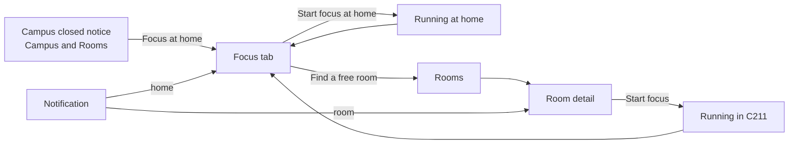

# Focus at home and session sounds

> **Status:** shipped in **v2.6** (milestone **M5 — Focus at home**, epic
> [#187](https://github.com/arudaev/THD-Room-Finder/issues/187)).
> Decisions: [ADR 0011](../architecture/adr/0011-focus-at-home.md) (a
> session has a place) and [ADR 0012](../architecture/adr/0012-session-sounds.md)
> (sounds). Builds on [focus sessions](focus-sessions.md) and
> [ADR 0004](../architecture/adr/0004-focus-rhythm.md). Design brief:
> [`design/brief/10-focus-at-home.md`](../../design/brief/10-focus-at-home.md);
> prototype: [`design/system/ui_kits/focus-at-home/`](../../design/system/ui_kits/focus-at-home/index.html).

## The idea in one paragraph

Most studying happens at home, in the evening and at weekends, when the
campus is closed and Room Finder has nothing to say. v2.6 lets a focus
session run **at home**: the same rhythm of blocks and breaks, the same
"Start block 3" after each break, the same focus graph, but no room, no
lecture and nobody else. A new **Focus** tab is where you start it and where
any running session lives. And because at home you put the phone down and
walk away, breaks now **sound like breaks**: coffee pours when a break
starts, a bright rising ding calls you back, a warm chord says you're done.

## Who it is for

| Person | Today | With v2.6 |
|---|---|---|
| Student who studies at home most days | The app is useless after 21:00 and at weekends | Focus at home, same rhythm and graph as on campus |
| Student who mixes campus and home | Only campus days show in the graph; the streak pauses at weekends whatever they did | Every focus day counts, wherever it happened |
| Student who leaves the phone across the room | A silent notification or the phone's default beep | A sound that says "break" or "back to it", even with the phone locked (Android app) |
| Student in a quiet campus room | Phone default sound | Unchanged by default: campus sounds stay the phone's own |

## Principles

1. **Same focus, different place.** A home session is a focus session. Same
   surface, rhythm, track, confirmation, graph and notifications. Only what
   depends on a room goes away: claims, batch, lectures, closing time, study
   tables.
2. **The place is chosen, never detected.** The app never reads the
   location. "At home" means anywhere that isn't a campus room: home, the
   town library, a café, the train.
3. **At home, nobody sees you.** Home sessions never leave the device, even
   signed in. Only the finished minutes sync to your focus graph, as today.
4. **Down for a break, up for focus.** Break sounds fall or settle; back-to-
   focus sounds rise; done resolves. Short, soft, never more than once plus
   one reminder.
5. **Quiet by default where it matters.** Sounds are on at home and stay the
   phone's own on campus, so nothing new rings in a lecture hall.

## Where things live

| Place | What changes |
|---|---|
| **Navigation** | **Campus · Rooms · Focus · Profile.** Focus sits between the room finder and your own things |
| **Every tab, a session runs** | The focus pill in the app bar (unchanged) shows the time left; a home session shows a house instead of a room code, and tapping it opens the Focus tab |
| **Focus tab, nothing running** | The *At home* card with **Start focus at home**, the rhythm and the sounds for this session; under it an *On campus* card that leads to Rooms (live: "38 rooms free now" or "Classroom buildings closed · opens Tue 06:30"); today's minutes and streak, linking to the focus graph |
| **Focus tab, a session runs** | The running session, wherever it is. A home session is controlled here. A campus session shows its room and **Open C211** for the room's own controls (Private/Public, Study together) |
| **Focus tab, just ended** | The summary ("1 h 40 min added") and **Start again** |
| **Campus and Rooms, classrooms closed** | The closed notice gets a **Focus at home** button |
| **Room detail** | Unchanged. Starting here while a home session runs says "This ends your session at home." |
| **Profile** | Unchanged layout. The graph's day detail adds "· 50 min at home" when part of the day was at home |
| **Settings → Focus** | Rhythm, **Sounds at home**, **Sounds on campus**, notifications |
| **Cold start** | Opening the app while a session runs lands on Focus |

## The Focus tab

### Nothing running

| Part | Content |
|---|---|
| App bar | "Focus" |
| At home card | House icon, **At home**, one line: "Only you see it. It counts in your focus graph." **Start focus at home** (filled, the Start focus button). Under it two lines, each with **Change**: the rhythm ("Pomodoro · 25 min focus, 5 min break") and the sounds ("Coffee break" with a speaker icon) |
| On campus card | Building icon, **On campus**, the live line, and **Find a free room** (opens Rooms) |
| Today | "Today 50 min · 3-day streak" and **View focus graph** |

A study table starting soon keeps its own reminder banner (unchanged).

### Running at home

The same violet focus surface as on room detail, with:

- a place chip at the top, house icon and **At home**, with a **speaker
  button** on the right that mutes or unmutes sounds for this session;
- the timer, block count, track and "Break at 20:40 · ends 23:15 at the latest";
- one plain line instead of Private/Public: "Only you see this session.";
- in breaks, one short break tip ("Stand up and stretch.");
- the lock-screen note and End.

"Break's over" and "Still focusing?" work exactly as on campus: **Start
block 3** leads, ten minutes to answer, then the session ends at the end of
the last block.

### Running on campus

The surface shows the room chip (**C211**) and **Open C211**; Private/Public
and Study together stay on room detail, where the room's context is. The
speaker button works the same.

## Sizes and orientations

The Focus tab is laid out by the shape of the window, not only its width:

| Window | Nothing running | A session runs |
|---|---|---|
| Phone upright (and any window under 600 px wide) | One column: At home, On campus, today | The surface, 48 px timer |
| Short landscape (wider than tall, under 560 px high: phones on their side, short laptop windows) | Two columns: At home beside On campus and today | Split surface: timer, track and plan on the left; note, tip and End on the right, so End never falls below the fold |
| Tablets and desktops (600 px wide and 560 px high or more), up to ultra-wide | Two columns, at most 960 px, in the optical centre of the window | A stage: the surface centred (560–880 px wide), the timer growing with the window up to 160 px so it reads across a room |

Room detail keeps its own layout; its surface gets the speaker in the title
row. Sheets (rhythm, sounds) become dialogs on wider windows and scroll when
the window is short.

## Planning a home session

| Rule | At home | On campus (unchanged) |
|---|---|---|
| End | 3 hours after the start at most; end any time | Next lecture, closing time or 3 h |
| Rhythm | Your default; **Change** for this session | Same |
| After each break | Start the next block within 10 minutes | Same |
| Timetable down | Doesn't matter | Runs to closing or 3 h (ADR 0009) |
| Campus closed, weekend, holiday | Doesn't matter | Can't start |
| Shared with the focus service | Never | With a study profile |
| Other devices | Not shown | A shared session shows there (ADR 0005) |
| Focus graph | Counts; minutes sync when signed in | Same |

One session at a time: starting at home while a campus session runs ends the
campus one (and its claim), and the other way round. The line under the
start button says so before you tap.

## Sounds

### Sets

Each set has three sounds. They are synthesised by
[`scripts/dev/focus_sounds.py`](../../scripts/dev/focus_sounds.py), so the
project owns them and can change them.

| Set | Break starts | Break's over | Session done |
|---|---|---|---|
| **Coffee break** (default at home) | Coffee poured into a cup, a spoon taps it | Three bright dings rising | A warm, open chord |
| **Jingle** | Marimba falls: sol, mi, do | Marimba climbs: do, mi, sol, do | A short marimba flourish |
| **Chimes** | Soft bells falling | Bells rising in a bright chord | A singing bowl |
| **Phone default** (default on campus) | The phone's notification sound | The same | The same |
| **Silent** | Vibration only (Android); nothing on the web | Same | Same |

### When they play

| Moment | Sound |
|---|---|
| Start focus, Start block N | None: you just tapped |
| A block ends and a break starts | Break |
| A break ends ("Break's over", "Still focusing?") | Break's over |
| 5 minutes later, still unanswered | Break's over, quieter, once |
| The plan ends | Session done |
| The session ends because nobody answered | None |
| End tapped | None |

### Where they come from

| | Android app | Web app (PWA) and desktop browsers | iPhone (home-screen PWA) |
|---|---|---|---|
| App open | Notification channel of the set | Played by the page | Played by the page |
| App in the background, phone locked | Notification channel: plays on time, also locked | Desktop: plays on time in a background tab. Android browser: with the notification, may be late | Only while the app is open (iOS limit) |
| Silent mode / Do Not Disturb | Respected | Browser plays at media volume; Phone default and Silent rely on the notification | Respected |
| Double sounds | Never: one channel per sound | The notification is silent when the page plays a set | Same |

The Android sounds need a new APK (the native shell changes), so v2.6 shows
"Update available" to installed apps ([ADR 0006](../architecture/adr/0006-android-self-update.md)).

### Settings → Focus → Sounds

Two rows, **Sounds at home** and **Sounds on campus**, each opening a sheet
with the five options, like the rhythm sheet: radio rows, Cancel and Done.
Every set has a play button that plays its break sound, then its
break's-over sound, so the pair is heard together. The choice is kept on the
device. The Focus tab's sound line opens the same sheet for home.

## Focus graph and streak

- Home minutes count the same as campus minutes: the graph, totals, share
  card and sync don't tell them apart.
- **Rest days count when you focused.** Weekends and the Christmas shutdown
  still pause the streak when empty, but a rest day with focus now adds a
  day. Before, a rest day never added, because focus needed an open campus.
- The day detail adds "· 50 min at home" when part of the day was at home.
  Where you focused stays on the device, like room codes.

## User stories

| # | As a student I want to… | So that… | Acceptance |
|---|---|---|---|
| HF-01 | start a focus session at home in one tap | I use the same rhythm at home | Focus tab → **Start focus at home**; the surface appears with "At home", block 1 running; no network needed |
| HF-02 | find my running session from anywhere | I never hunt for the timer | The Focus tab shows any running session; the app-bar pill shows it on every other tab (a house for home); cold start lands on Focus |
| HF-03 | a home session without campus rules | lectures and closing times don't cut my evening | Plan = up to 3 h from the start; no lecture guard, closing, timetable or claim; Start block N works as on campus |
| HF-04 | nobody to see my home sessions | studying at home stays private | Never sent to the focus service, not adopted by other devices; minutes sync after the end as today |
| HF-05 | a way to focus when the campus is closed | the app isn't a dead end at night | Closed notice on Campus and Rooms has **Focus at home** → Focus tab |
| HF-06 | to know what happens to my other session | I don't lose a campus claim by accident | Start lines say "This ends your session in C211." / "…at home."; the old session is recorded and ended |
| HF-07 | weekend study to count for my streak | the streak rewards what I actually did | A rest day with focus adds a day; an empty one pauses; day detail shows home minutes |
| HF-08 | notifications that say where I am | the lock screen makes sense | "Focus · At home", "Break · At home"; tapping opens the Focus tab |
| HF-09 | the same on tablet, desktop and a phone on its side | I can focus at my laptop or with the phone propped up | See [Sizes and orientations](#sizes-and-orientations): one column, split or a centred stage; End always on screen |
| SN-01 | a pleasant sound when a break starts | I notice and actually take it | Break sound of the place's set at each block end |
| SN-02 | an inviting sound when the break is over | I come back on time | Break's-over sound, then once more, quieter, 5 minutes later if unanswered |
| SN-03 | a sound when the session is done | I know I finished | Done sound at the planned end only |
| SN-04 | to choose sounds for home and campus | it fits where I am | Settings → Focus → Sounds at home / on campus; five options; preview; defaults Coffee break / Phone default |
| SN-05 | to silence one session | a call or a sleeping flatmate doesn't need a chime | Speaker button by the place chip; for this session only |
| SN-06 | to hear it with the phone locked | I can put the phone away | Android app: notification channels per sound; silent mode and Do Not Disturb respected |
| SN-07 | sounds on my laptop too | I can focus at my desk | Web: scheduled on the audio clock so a background tab plays on time; no double sound with the notification |
| BT-01 | a nudge for what to do in a break | the break actually rests me | One short tip per break, rotating; none in the Open rhythm |

## Failure and edge cases

| Case | Behaviour |
|---|---|
| Offline, signed out, no study profile | Home focus works fully |
| Signed in and a shared campus session runs on another device | Starting at home here doesn't touch it; the Focus tab shows it once adopted (ADR 0005) as today |
| Browser blocked autoplay (page reloaded mid-session) | The surface shows "Tap to turn sounds back on" until any tap |
| Sound files fail to load | Fall back to the notification's own sound; never block focus |
| Session over midnight | Counted on the day it started (unchanged) |
| Time travel in Rooms | Doesn't affect the Focus tab |
| Android app on an old APK (no sound channels) | Web bundle updates first; until the APK is updated, Android plays the default alert sound as today |
| Reduced motion | No change; sounds are not motion |

## Privacy

- No location, ever. "At home" is a button, not a measurement.
- Home sessions send nothing. The place of a session stays on the device;
  synced history keeps only dates and minutes ([ADR 0005](../architecture/adr/0005-focus-across-devices.md)).
- Notifications show "At home" and the phase on the lock screen, nothing else.

## Out of scope for v2.6, kept in mind

| Idea | Why later |
|---|---|
| Study together online (a study table without a room) | Needs a table without a room and a different invite; fits [#23](https://github.com/arudaev/THD-Room-Finder/issues/23) |
| Home sessions across devices | Needs the focus service to hold sessions without a room; privacy trade-off |
| Keep the screen on during a session | Wake lock drains battery; revisit after the pilot |
| Separate stats per place | The graph should stay one habit, not two |
| Your own sounds | File handling and licensing; the five options cover the pilot |
| Skip a break or extend a block | Unchanged from ADR 0004 |
