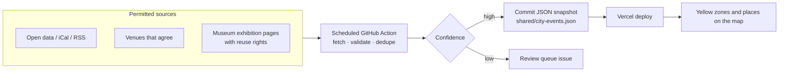

# Later phases

Outlines for the phases after Phase 1. These are **directions, not
commitments**: each becomes concrete sub-issues when the previous milestone is
nearly done. The epics hold the candidate stories.

## Phase 2 · M2 — Group focus and profiles ([#23](https://github.com/arudaev/THD-Room-Finder/issues/23))

**Outcome:** a public focus session can grow into a group that studies
together, and students recognise each other.

First slice, specified: [study tables](study-tables.md).

| Capability | Notes |
|---|---|
| Group session | Several participants, each with their own lease; the group lives while anyone is in it |
| Join from map or list | One tap starts your own timer inside the group |
| Profiles | Unique handle plus a free display name (Discord-style); optional avatar colour from vetted swatches |
| Friends-lite | Follow a few classmates to see their public sessions first; no feed, no chat |
| Planned sessions | "AIN 7 in I112 at 14:00", announced ahead, never a reservation |
| "This room is empty" report | Lets students clear stale claims; abuse-limited |

## Phase 2 · M3 — Organizations and gatherings ([#24](https://github.com/arudaev/THD-Room-Finder/issues/24))

**Outcome:** student organizations (for example ESN, Campus Connect, faculty
councils, clubs) announce gatherings and open study sessions with a verified
tag.

Specified: [student organizations](organizations.md), verified in a public
registry run by THD AI.

| Capability | Notes |
|---|---|
| Organization account | Verified membership; members post on behalf of the org |
| Paid tier | Around €1.99 per organization per month to cover hosting. **Payment never counts as verification.** |
| Announcements | Room or place, time, recurrence, description, cancellation |
| Org-hosted focus sessions | Open to everyone; shown with the org tag |
| Moderation | Report, hide, revoke; audit trail |

Room use stays an **announcement**. Official bookings remain with THD; the app
links to the official process and never pretends to book.

Open questions: payment provider, invoices and VAT for a student project,
verification process, liability for announcements.

## Phase 3 · M4 — City layer ([#25](https://github.com/arudaev/THD-Room-Finder/issues/25))

**Outcome:** Deggendorf around the campus becomes part of the map. What is
happening, where and when, drawn as **yellow zones** like sectors in a game:
"something is happening on Luitpoldplatz on Saturday".

| Capability | Notes |
|---|---|
| City base map | Extend the 2.5D SVG renderer beyond campus; selected streets and squares |
| Events | Place or street segment, time window, category, source, image |
| Zones | Yellow area for active events, outline for upcoming; "today / this weekend" filter; "events only" mode |
| Places | Museums and venues as permanent yellow places with current exhibitions and preview images |
| Automation | Scheduled CI ingests, validates and commits snapshots; a PR or review issue for anything uncertain |

Hard rule: every source needs a licence or permission, and every image a
reuse right. No scraping of sources that forbid it.

The colour **ochre/yellow** is reserved for this layer from Phase 1 on, so
nothing else claims it in the meantime. It is kept visually distinct from the
amber "closing soon" status.

## Ideas parked outside the phases

| Idea | Why parked |
|---|---|
| iOS app | Needs an Apple developer account; the PWA covers iOS meanwhile |
| Other THD campuses (Pfarrkirchen, Cham, …) | Only with demonstrated local demand; a room list may suffice without a map |
| In-app GitHub Discussions view | A link to Discussions is enough for now |
| Calendar export of focus sessions | Revisit after group sessions |
