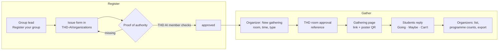

# Student organizations and gatherings

Phase 2 · M3. Verified student groups host **gatherings**: a game night, a
planning meeting, a talk, a big group focus session. Students keep their
[study tables](study-tables.md) (up to 12 seats); anything bigger belongs to
an organization. Decisions are in
[ADR 0008](../architecture/adr/0008-organization-registry.md).

## The idea in one paragraph

A gathering is **a study table, grown**. A verified group sets it in a room
THD approved for them; the room's seats are the capacity. The page, the link,
the replies and the reminder are the table's. Only the ring changes: instead
of a few seats around the room code it carries one dot per person who
replied, with the count in the middle. Organizers see who is coming and what
to plan with; everyone else sees the room as taken for that time.

## Principles

1. **Groups register themselves.** Nobody creates an organization for someone
   else. The only organization set up by us is THD AI. A group applies with
   an issue form and shows that the applicant speaks for it.
2. **Rooms are approved by THD, not by the app.** A gathering needs the
   group's room approval from THD. The app records it and shows it; it never
   books a room.
3. **Capacity comes from the room.** The room's seat count from THabella;
   the organizer can lower it, never raise it.
4. **The table, grown.** Same card, same ring shape, one violet action, the
   same words. Nothing new to learn after a study table.
5. **People, not seats.** A dot is a person who replied, in the order they
   replied. Nobody reserves a place; outlines only show how many more fit.
6. **Replies tell organizers what they need.** Going, Maybe, Can't, and for
   organizers a list with name, programme and batch, shared only with consent.

## Words

| Word | Means | Never say |
|---|---|---|
| Gathering | An organization's planned get-together in one room | Event booking, reservation |
| Type | Group focus, Game night, Talk or Meeting: a tag and its words | Layout, setup |
| Going · Maybe · Can't | Replies | RSVP |
| Waiting list | Replies after the room is full | Queue |
| Organizers | The group's members who host it | Admins |
| Verified | The group passed the registry | Official, partner |

German: Treffen, Art (Gemeinsam lernen, Spieleabend, Vortrag, Treffen),
Komme, Vielleicht, Kann nicht, Warteliste, Organisationsteam, Verifiziert.

## The ring

| Rule | Value |
|---|---|
| Size | 13 people up to the room's seat count from THabella, at most 300. 12 and below is a study table |
| Unknown room size | The organizer enters it, 13 to 300 |
| Lowering | Any time, down to the people already going; never above the room |
| Shape | The study table's ring: a round table in the middle, dots on one circle around it |
| Middle | The going count, large, and "of 60" under it (the room code moves to the details) |
| Order | Dots fill clockwise from the top in the order people replied |
| Going · Maybe · Room left | A full violet dot · a dot half violet, half white · an outline |
| Changing a reply | Maybe → Going fills that dot in place. Can't removes it; later dots move up one |
| Many people | At most 36 dots on a page or banner, 12 on a small ring in a list; above that one dot stands for several people, a pair with any maybe draws as a maybe, and the details say "one dot = 7 people" |
| Full | Going reaches the size: the ring is closed and the one action is **Join the waiting list** |
| Your own dot | Not marked. "You're going" says it |

Only violet and white carry meaning, so the ring reads the same in light and
dark mode and at chat size.

## Types

A type is a tag on the card and the words around it; it changes nothing
else.

| Type | For |
|---|---|
| **Group focus** | A big study session, exam prep for a whole module; starts a focus session for everyone, like a table |
| **Game night** | Game nights, socials, workshops |
| **Talk** | A talk, a pitch night, a performance |
| **Meeting** | A club or planning meeting |

## Share banner

The link preview is how most people first see a gathering, so it carries the
ring. A 1200 × 630 image per link: the ring large on the violet brand
background with the count on it, and the text "Game night · Thu 5 Nov, 19:00
· I 112" and "Campus Connect · 27 of 60 going, 8 maybe. Reply Going, Maybe or
Can't." No names. Tables use the same banner with their seat ring.

## Phones, tablets and desktops

As for [study tables](study-tables.md#phones-tablets-and-desktops): one
column on phones with the action in thumb reach; on wide windows the ring at
240 beside the details. Organizers see two plain lines under the card,
"Expect about 150" (going plus half the maybes) and the top programmes, with
**People** opening the list, beside the card on wide windows.

## Flow



## User stories

### Registering

| # | As a… | I want to… | So that… | Acceptance |
|---|---|---|---|---|
| O1 | group lead | register my group | it can host gatherings | **Register your group** in Profile and under the 12-seat chip opens the issue form, prefilled with a request number |
| O2 | group lead | show I speak for the group | a random member can't claim it | The form asks for my role and one proof: a post from the group's official account naming the request number, a page of the group listing me in its board, or a confirmation from the student union |
| O3 | applicant | follow the request | I know what is missing | Labels move it from *Waiting for proof* to *In review* to *Approved*, *Needs info* or *Declined*; every change comments on the issue and shows in the app |
| O4 | THD AI member | approve with a label | verification is quick and on record | Only a THD AI member who is not the applicant can approve; the workflow refuses otherwise |
| O5 | group lead | add organizers with a link | the team can host without sharing a login | An organizer link, valid 7 days, adds a signed-in student as organizer |
| O6 | THD AI member | revoke a group | a group that misuses the tag loses it | Label *Revoked*; open gatherings show "No longer verified" |

### Gathering

| # | As a… | I want to… | So that… | Acceptance |
|---|---|---|---|---|
| O7 | organizer | create a gathering in a room | people know where and when | **New gathering** on room detail, for organizers only: day and free slot (like tables), type, name, capacity, approval reference |
| O8 | organizer | record THD's room approval | students trust it | A required field for the approval reference and a confirmation that THD approved this room and time |
| O9 | organizer | get capacity from the room | I don't count chairs | Seats = the room's seat count; I can lower it. Rooms without a known count ask for one, up to 300 |
| O10 | organizer | share it with many people | it reaches everyone | The same word link (`/g/mossy-lagoon-42`), a chat preview, and a printable poster with a QR code |
| O11 | student | reply in one tap | the organizers can plan | Going · Maybe · Can't, signed in with the email code. Before the first reply: "Campus Connect sees your name, programme and batch" |
| O12 | student | a waiting list when full | I still get in if someone cancels | Full gatherings offer **Join the waiting list**; the first in line moves up when a seat frees, and gets told |
| O13 | organizer | see who is coming | I can plan food, tables, a second room | A list with name, programme, batch, reply and time; counts per programme; CSV export; only organizers see it |
| O14 | student | see the room is taken | I don't plan a table there | Rooms with a gathering show "Taken · Game night · Campus Connect" for that time, on the map and in slot chips |
| O15 | student | open a group's page | I see what it does next | `/o/<slug>`: name, verified tag, description, website, upcoming gatherings, support link |
| O16 | student | report a gathering | misuse gets looked at | **Report** opens a prefilled issue in the registry, no personal data |

## Where things live

| Place | What appears | Who sees it |
|---|---|---|
| Room detail | "Taken · Game night · Campus Connect" for the time of a gathering | Everyone |
| Map and room list | The room counts as taken during a gathering | Everyone |
| Profile | Gatherings sit in **Your tables** with your reply; organizers also see them there with counts | Me |
| `/g/<link>` | Gathering page with the ring | Anyone with the link |
| `/o/<slug>` | Group page | Everyone |
| Profile → Register your group | The registry form | Signed-in students |

## Gathering page

```
┌────────────────────────────────┐
│ ‹  Gathering                   │
│ Game night      ✓ Campus Conn. │
│         ◐ ● ● ●                │
│      ○    ┌──┐   ●             │  the table's ring, grown:
│      ○    │27│   ●             │  dots in reply order,
│      ○    └──┘   ◐             │  count in the middle
│         ○ ○ ● ●                │
│ Game night                     │
│ Thu 5 Nov · 19:00–22:00        │
│ I 112 · room approved by THD   │
│ 27 going · 8 maybe · 60 seats  │
│ [ Going ]   Maybe   Can't      │
└────────────────────────────────┘
```

| State | Shows |
|---|---|
| Guest | Ring, details, **Going**; replying asks for the email code and shows what the group sees |
| Going or maybe | "You're going" or "You said maybe", the other two answers, Share link |
| Full | "Full · 40 of 40" tag, **Join the waiting list** |
| Waiting | "You're number 3 on the waiting list" |
| Organizer | "Expect about 150", top programmes, **People**, Share link, Poster, Export, Change, Cancel |
| Cancelled | Ring greyed with a dashed edge, "Cancelled by Campus Connect" |
| Not verified any more | "No longer verified" tag, replies closed |

## What verification means

A THD AI member checks the proof in the public issue. Payment never counts as
verification, and nothing personal goes into the issue: the app sends only
the group's public fields and a request number. Proof that names the request
number (a story or post from the official account, a line on the group's
website) is preferred because it cannot be reused.

## Support links

Each group can list its own support link on its page (GitHub Sponsors, Buy
Me a Coffee, a club account). Support goes to that group only; the app
handles no money and takes no share. THD AI lists its own link like any other
group.

## Privacy

- Students choose to share name, programme and batch with a group when they
  first reply; the reply shows what is shared. Without consent they can't
  reply, but they can still see the gathering.
- Only organizers see the list; exports carry no email addresses.
- Gatherings and replies are deleted 30 days after the end; the counts stay
  with the group as numbers only.

## Registry

`THD-AI/organizations` holds the issue form, one JSON file per verified
group and the approval workflow. The form is the whole application; the repo
is just where it is kept. The app reads verified groups from the database,
which the workflow keeps in step with the registry.

## Out of scope for M3

Ticketing and payments, seat numbers, check-in at the door, recurring
gatherings, chat, gatherings without a THD room approval.
