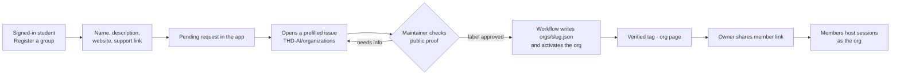

# Student organizations

Phase 2 · M3. Student groups host open study sessions and gatherings with a
verified tag. Decisions are in
[ADR 0008](../architecture/adr/0008-organization-registry.md).

## The idea in one line

Organizations are **planned sessions with a verified host**. Registration and
verification happen in the open, in a public registry run by the
[THD AI](https://github.com/THD-AI) organization on GitHub, so anyone can see
who is verified and why.

Nobody creates an organization for someone else. The only organization set
up by us is THD AI itself.

## Flow

## User stories

| # | As a… | I want to… | So that… |
|---|---|---|---|
| O1 | student who runs a group | register it from the app | it can host sessions under its name |
| O2 | applicant | follow the request in the app and on GitHub | I know what is missing |
| O3 | maintainer | approve with a label | verification is quick and on record |
| O4 | org owner | invite members with a link | the team can host without sharing a login |
| O5 | org member | host a planned session as the org | students see it comes from the group |
| O6 | student | open an org page | I see its upcoming open sessions and how to support it |
| O7 | student | report a misleading session | it gets looked at |
| O8 | maintainer | revoke an org with a label | a group that misuses the tag loses it |

## What verification means

A maintainer checks public proof that the applicant speaks for the group: for
example a post on the group's official site or account that names the
request number. The proof link is in the public issue. **Payment never counts
as verification**, and nothing personal goes into the issue: the app sends
only the public fields and a request number.

## Org page

`/o/<slug>`: name, verified tag, short description, website, upcoming open
sessions and, if the group has one, a **Support** link to its own donation
page. The app handles no money.

## Registry

`THD-AI/organizations` holds one JSON file per verified group and the issue
form. The app reads verified orgs from the database, which the workflow keeps
in step with the registry. The registry is the public record; the database is
the copy the app uses.
