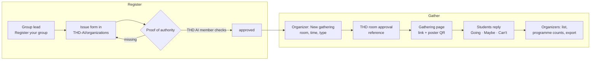

# Student organizations and gatherings

Phase 2 · M3. Verified student groups host **gatherings**: a game night, a
planning meeting, a talk, a big group focus session. Students keep their
[study tables](study-tables.md) (up to 12 seats); anything bigger belongs to
an organization. Decisions are in
[ADR 0008](../architecture/adr/0008-organization-registry.md).

## The idea in one paragraph

A gathering is **a study table for a whole group**. A verified group sets it
in a room THD approved for them, and its page reads like a table's: one card,
one picture, one violet action, the same link, replies and reminder. The
picture is the room set up for the gathering's type, with the room code
where the front is, and people appear in it in the order they replied.
Organizers see who is coming and what to plan for; everyone else sees the
room as taken for that time.

## Principles

1. **Groups register themselves.** Nobody creates an organization for someone
   else. The only organization set up by us is THD AI. A group applies with
   an issue form and shows that the applicant speaks for it.
2. **Rooms are approved by THD, not by the app.** A gathering needs the
   group's room approval from THD. The app records it and shows it; it never
   books a room.
3. **Capacity comes from the room.** The room's seat count from THabella;
   the organizer can lower it, never raise it.
4. **Like a study table.** Same card, same words, one violet action. The
   room code is the label on the picture, as on a table.
5. **People, not numbers.** The picture shows people arriving, not a score.
   Counts are a quiet line under the title; there is no big number and no
   "of 120", so a new or small gathering never looks dead.
6. **Nobody reserves a seat.** A dot is a person who replied, placed in reply
   order. Your own dot is not marked.
7. **Replies tell organizers what they need.** Going, Maybe, Can't, and for
   organizers a list with name, programme and batch, shared only with consent.

## Words

| Word | Means | Never say |
|---|---|---|
| Gathering | An organization's planned get-together in one room | Event booking, reservation |
| Type | Group focus, Game night, Talk or Meeting | Layout, setup |
| Going · Maybe · Can't | Replies | RSVP |
| Waiting list | Replies after the room is full | Queue |
| Organizers | The group's members who host it | Admins |
| Verified | The group passed the registry | Official, partner |

German: Treffen, Art (Gemeinsam lernen, Spieleabend, Vortrag, Treffen),
Komme, Vielleicht, Kann nicht, Warteliste, Organisationsteam, Verifiziert.

## Types

The type sets the picture, the tag and the words. There is no circle setup.

| Type | For | Picture | Where the room code sits |
|---|---|---|---|
| **Group focus** | A big study session, exam prep for a whole module; starts a focus session for everyone, like a table | Round tables of 6, like study tables | A plate above the tables |
| **Game night** | Game nights, socials, workshops | Long tables of 8, four a side | A plate above the tables |
| **Talk** | A talk, a pitch night, a performance | An auditorium: a half circle of rows facing the stage | On the stage |
| **Meeting** | A club or planning meeting | A classroom: rows facing the front | On the front plate |

## The picture

| Rule | Value |
|---|---|
| Size | 13 people up to the room's seat count from THabella, at most 300. 12 and below is a study table |
| Unknown room size | The organizer enters it, 13 to 300 |
| Lowering | Any time, down to the people already going; never above the room |
| Order | People appear in the order they replied: table by table (Group focus, Game night), or row by row from the front, centre first (Talk, Meeting) |
| Going | A violet dot |
| Maybe | A light violet dot with a violet edge |
| Free place | A faint outline. It shows the room's size without competing with the people |
| Changing a reply | Maybe → Going changes that dot in place. Can't removes it; later dots move up one |
| Many people | One dot per person up to 120; above that one dot per two, said in the details |
| Full | Going reaches the size: "Full" tag, and the one action is **Join the waiting list** |
| Counts | One line under the title: "27 going · 8 maybe". The room's seats are a detail: "I 112 · 48 seats" |

## Share banner

The link preview is how most people first see a gathering, so it carries the
picture: the room set up, the room code at the front and the people in it, in
white on the violet brand background. The text says "Founders talk · Wed 18
Nov, 18:30 · A 008" and "Talk by Fast Forward. Reply Going, Maybe or Can't."
No counts and no names. Tables use the same banner with their seat ring.

## Phones, tablets and desktops

As for [study tables](study-tables.md#phones-tablets-and-desktops): one
column on phones with the action in thumb reach; on wide windows the picture
at 480 px beside the details. Organizers see two plain lines under the card,
"Plan for about 25" (going plus half the maybes) and the top programmes, with
**People** opening the list beside the card on wide windows.

## Flow



## User stories

### Registering

| # | As a… | I want to… | So that… | Acceptance |
|---|---|---|---|---|
| O1 | group lead | register my group | it can host gatherings | **Register your group** in Profile and under the 12-seat chip opens the issue form, prefilled with a request number |
| O2 | group lead | show I speak for the group | a random member can't claim it | The form asks for my role and one proof: a post from the group's official account naming the request number, a page of the group listing me in its board, or a confirmation from the student union |
| O3 | applicant | follow the request | I know what is missing | Labels move it from *Waiting for proof* to *In review* to *Approved*, *Needs info* or *Declined*; every change comments on the issue and shows in the app |
| O4 | THD AI member | approve with a label | verification is quick and on record | Only a THD AI member who is not the applicant can approve; the workflow refuses otherwise |
| O5 | group lead | add organizers with a link | the team can host without sharing a login | An organizer link, valid 7 days, adds a signed-in student as organizer |
| O6 | THD AI member | revoke a group | a group that misuses the tag loses it | Label *Revoked*; open gatherings show "No longer verified" |

### Gathering

| # | As a… | I want to… | So that… | Acceptance |
|---|---|---|---|---|
| O7 | organizer | create a gathering in a room | people know where and when | **New gathering** on room detail, for organizers only: day and free slot (like tables), type, name, capacity, approval reference |
| O8 | organizer | record THD's room approval | students trust it | A required field for the approval reference and a confirmation that THD approved this room and time |
| O9 | organizer | get capacity from the room | I don't count chairs | Seats = the room's seat count; I can lower it. Rooms without a known count ask for one, up to 300 |
| O10 | organizer | share it with many people | it reaches everyone | The same word link (`/g/mossy-lagoon-42`), a chat preview, and a printable poster with a QR code |
| O11 | student | reply in one tap | the organizers can plan | Going · Maybe · Can't, signed in with the email code. Before the first reply: "Campus Connect sees your name, programme and batch" |
| O12 | student | a waiting list when full | I still get in if someone cancels | Full gatherings offer **Join the waiting list**; the first in line moves up when a seat frees, and gets told |
| O13 | organizer | see who is coming | I can plan food, tables, a second room | A list with name, programme, batch, reply and time; counts per programme; CSV export; only organizers see it |
| O14 | student | see the room is taken | I don't plan a table there | Rooms with a gathering show "Taken · Game night · Campus Connect" for that time, on the map and in slot chips |
| O15 | student | open a group's page | I see what it does next | `/o/<slug>`: name, verified tag, description, website, upcoming gatherings, support link |
| O16 | student | report a gathering | misuse gets looked at | **Report** opens a prefilled issue in the registry, no personal data |

## Where things live

| Place | What appears | Who sees it |
|---|---|---|
| Room detail | "Taken · Game night · Campus Connect" for the time of a gathering | Everyone |
| Map and room list | The room counts as taken during a gathering | Everyone |
| Profile | Gatherings sit in **Your tables** with your reply; organizers also see them there with counts | Me |
| `/g/<link>` | Gathering page with the picture | Anyone with the link |
| `/o/<slug>` | Group page | Everyone |
| Profile → Register your group | The registry form | Signed-in students |

## Gathering page

```
┌────────────────────────────────┐
│ ‹  Gathering                   │
│ Talk           ✓ Fast Forward  │
│      ○ ○ ○ ○ ○ ○ ○ ○ ○         │
│    ○ ○ ● ● ◍ ● ○ ○ ○ ○         │  the room set up as an
│   ○ ● ● ● ● ● ◍ ● ○ ○          │  auditorium; people from
│        [ A008 ]                │  the front, in reply order
│ Founders talk                  │
│ Wed 18 Nov · 18:30–20:00       │
│ A 008 · 120 seats · approved   │
│ 52 going · 16 maybe            │
│ [ Going ]   Maybe   Can't      │
└────────────────────────────────┘
```

| State | Shows |
|---|---|
| Guest | Picture, details, **Going**; replying asks for the email code and shows what the group sees |
| Going or maybe | "You're going" or "You said maybe", the other two answers, Share link; Group focus adds **Start focus** from 15 minutes before |
| Full | "Full" tag, **Join the waiting list** |
| Waiting | "You're number 3 on the waiting list" |
| Organizer | "Plan for about 25", top programmes, **People**, Share link, Poster, Export, Change, Cancel |
| Cancelled | Picture greyed, "Cancelled by Campus Connect" |
| Not verified any more | "No longer verified" tag, replies closed |

## What verification means

A THD AI member checks the proof in the public issue. Payment never counts as
verification, and nothing personal goes into the issue: the app sends only
the group's public fields and a request number. Proof that names the request
number (a story or post from the official account, a line on the group's
website) is preferred because it cannot be reused.

## Support links

Each group can list its own support link on its page (GitHub Sponsors, Buy
Me a Coffee, a club account). Support goes to that group only; the app
handles no money and takes no share. THD AI lists its own link like any other
group.

## Privacy

- Students choose to share name, programme and batch with a group when they
  first reply; the reply shows what is shared. Without consent they can't
  reply, but they can still see the gathering.
- Only organizers see the list; exports carry no email addresses.
- Gatherings and replies are deleted 30 days after the end; the counts stay
  with the group as numbers only.

## Registry

`THD-AI/organizations` holds the issue form, one JSON file per verified
group and the approval workflow. The form is the whole application; the repo
is just where it is kept. The app reads verified groups from the database,
which the workflow keeps in step with the registry.

## Out of scope for M3

Ticketing and payments, seat numbers, check-in at the door, recurring
gatherings, chat, gatherings without a THD room approval.
