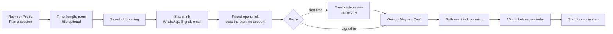

# Planned sessions and invites

Phase 2 · M2. Plan a study session ahead, alone or with friends, share one
link, and see who is coming. Decisions are in
[ADR 0007](../architecture/adr/0007-planned-sessions.md).

## The idea in one line

A **planned session** is a focus session with a date: a time, a length and
usually a room. Share its link and it becomes a group plan; people reply
**Going**, **Maybe** or **Can't**. At the time, everyone taps **Start focus**
and studies in step, like today's Join.

It stays an announcement. The app never books a room and says so.

## Flow

## User stories

| # | As a student, I want to… | So that… | Notes |
|---|---|---|---|
| P1 | plan a session for a later time, with a length and a room | I have a place and a rhythm before I arrive | Time defaults to the next full hour. Length uses the focus rhythms. Room picker shows rooms free for the **whole** window, longest-free first, from the same THabella data as the list |
| P2 | plan without a room | I can decide on the day | "Room: decide later". Start focus then opens the free-room list |
| P3 | share a link to my plan | friends can see it in WhatsApp without installing anything | The preview card shows title, day, time and room. No names in the preview |
| P4 | open a plan link without an account | I can decide if I want to come | Details, room status at that time, and how many are going |
| P5 | reply Going, Maybe or Can't | the host knows who is coming | First reply asks for the email code, the same sign-in as today. Only a display name is needed, no batch |
| P6 | see who is coming | I know who to expect | Names of people who chose to show their name, otherwise "and 2 more" |
| P7 | invite by email as well | friends without the chat get it too | Opens your mail app with the link; the app sends no email itself |
| P8 | see my upcoming plans and replies in one place | I don't lose track of my friends' sessions | Profile → Upcoming, next first. Ended plans disappear |
| P9 | change or cancel my plan | people aren't sent to the wrong place | Guests see **Changed** or **Cancelled** on the plan and in Upcoming |
| P10 | get a reminder 15 minutes before | I leave on time | Device notification on Android, a banner in the web app |
| P11 | start focus from the plan | the group studies in step | Starts a normal focus session in the plan's room with its rhythm; others join in step |
| P12 | know if a lecture appears in the room | we don't walk into a class | The plan shows "A lecture is now scheduled here" and offers free rooms at that time |

Later, not in this milestone: "show to my batch" listing, recurring plans,
calendar export.

## Screens

- **Plan sheet** – one sheet, four rows: When · Length · Room · Title. A
  single **Save** button. Opens from a room (room prefilled) or from Profile
  (**Plan a session**).
- **Plan page** – `/p/<code>`. Title, day and time, room with its status at
  that time, the reply buttons, who is coming, then **Share** and, for the
  host, **Edit**. Same card style as room detail.
- **Upcoming** – a short list on Profile above Saved rooms; hidden when empty.

## Rules

| Rule | Value |
|---|---|
| How far ahead | Up to 60 days |
| Length | 25 minutes to 3 hours, the same cap as a focus session |
| Upcoming plans you host | Up to 10 at a time |
| Title | Optional, up to 60 characters, plain text |
| Link | `/p/` plus 10 random characters; anyone with the link can view and reply |
| Kept on the server | Until 24 hours after the end, then deleted |
| Names | Shown only if that person turned on "show my name" |

## Privacy

The server stores the plan (host, title, room, time, rhythm, link code) and
each reply (who, which answer, whether the name is shown). No email address
is stored with a plan; sign-in stays with Supabase Auth. Link previews read a
reduced view without names. Everything is deleted a day after the plan ends.
