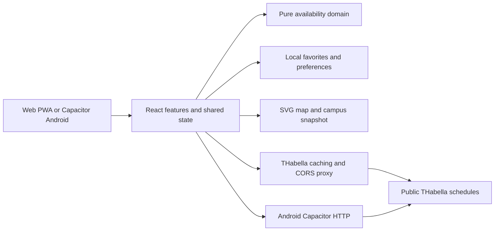
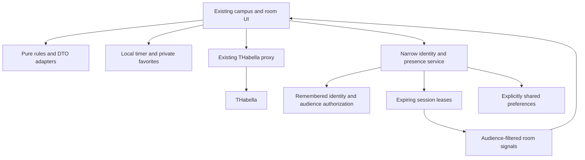
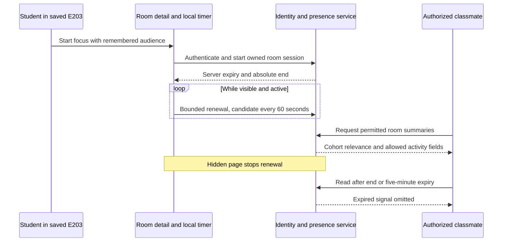

# Future architecture options

> **Research snapshot, 10 October 2026.** Kept for its evidence and reasoning. Where it conflicts with the [charter](../../../PROJECT-CHARTER.md) or the [focus sessions spec](../focus-sessions.md), those win.

Status: selected M1 architecture direction, **10 October 2026**, governed by [PROJECT-CHARTER.md](../../../PROJECT-CHARTER.md). The shipped app remains accountless/proxy-only; M1 plans a narrow identity/presence service. Implementation must settle environment/auth/RLS and budgets in M1-S1. Group/event records below are later options, not M1 requirements. Defensive DTOs and pure tested domain logic remain mandatory.

## Capability boundary

### Current implementation



There is no shared student/session database in this architecture. A personal focus timer can fit locally; shared presence cannot be made authoritative by storing data on one participant's device.

| Capability | Can stay client-only? | Consequence |
|---|---|---|
| Room search, local favorites, campus preference | Yes, existing model | Preserve offline usefulness and domain eligibility |
| Personal focus timer and screen-awake request | Yes | Visible-page capability, not guaranteed background execution |
| Shared focus, cohort aggregates and friends | No | Short-lived leases, audience authorization, optional identity and consented preferences |
| Dated suggestion link and one-time calendar export | Yes | Link carries intent, not authoritative live state; revalidate on opening |
| Reviewed static event directory | Yes, maintained with releases | Corrections wait for publication; expiry must be deterministic |
| Multi-person voting / shared RSVPs | No reliable shared state without a service | Requires persistence, authorization, expiry, concurrency and abuse controls |
| Organizer publishing and cancellation | Requires a service for timely self-service | Requires host identity, moderation, audit trail and recovery |
| Push while app is closed | Requires push delivery infrastructure | A service worker is not an always-running timer or polling daemon |
| Cross-device sync/calendar subscriptions | Requires a durable service or external provider | Adds identity, retention, feed revocation and support |

Do not grow the THabella proxy into a hidden social backend. Keep authoritative timetable retrieval separate from community coordination. Available Vercel/Supabase/Railway access does not select a vendor or justify provisioning one during research.

## Options for a later ADR

**A — local companion:** keep the current deployment model and add shareable suggestions, calendar export, source links, and optionally a reviewed static directory. Lowest operational burden; no shared voting or delivery guarantees.

**B — private coordination service:** short-lived gatherings and votes, host management, capability-based invite links or optional authentication. Narrow pilot scope; anonymous participation still requires server-side permissions and rate limits. Decide recovery, expiration and token-loss behavior before claiming accountless convenience.

**C — organizer community service:** verified hosts, public event records, moderation, subscriptions and delivery. Can coexist with accountless room browsing. Highest operational cost; proceed only with named ownership and proven demand.

**Selected M1 recommendation:** narrow Supabase Auth/Postgres/RLS identity/presence capability, with audience-filtered summaries and server-validated leases. Shared identity remembers degree/batch/default audience; room browsing/local favorites/private timer stay accountless. Keep timetable retrieval separate. Public organizations, friends and invite/poll records are later scope. Actual entitlement/cost/auth-provider choices are verified before service activation.

### Selected M1 service boundary, details settled by M1-S1



This describes logical boundaries within a small service/database, not separate deployed microservices. Supabase Auth/Postgres/RLS is the recommended M1 direction; M1-S1 verifies the actual entitlement, isolation and cost before activation. Preserve the existing proxy's narrow purpose and support a feature-off fallback to ordinary room finding. Plans/votes/events/notifications are later modules.

Evaluate options on authorization correctness, regional hosting/data transfers, restore/backups, observability, delivery reliability, anticipated volume, cost, portability, and maintainers' support capacity. Select through an ADR, not possession of admin credentials. No administrative token belongs in a client bundle, document, screenshot, or commit.

## Proposed boundaries and records

Retain `src/domain` for interval/quorum/expiry/venue rules with Vitest tests. Add future network adapters in data and state providers in features; domain imports neither. Reuse Material 3 components and `t(en, de)`. Add explicit DTO mappers for every new upstream format; an unknown venue must not become a guessed building.

Candidate identities: `CampusId`, `BuildingId`, `VenueId`, and a separate upstream room identifier. Building “A” must not uniquely identify a location across campuses. A venue may be a teaching room, amenity, public gathering place, or online link; only teaching-eligible rooms enter the free-study-room list.

M1 records: `StudentIdentity`, `AudiencePreference`, `FocusSession` and single-owner/device-scoped `PresenceLease`. One active session per identity; degree/cohort are self-declared; mode and audience are separate. Unrelated viewers can receive a coarse activity summary for ranking without private names/cohort fields. Use server-side authorization/RLS and expiry filtering. Never download unauthorized raw records and hide them in the UI.

Later candidate records, **not M1 prerequisites**:

- `Gathering`: owner, visibility, campus, purpose, slots, duration, quorum, deadline, lifecycle, version, expiry.
- `Vote`: gathering, participant reference, slot, yes/maybe/no, version; unique constraint prevents duplicate votes by the same participant token.
- `Meeting`: confirmed slot, venue, state and last availability check; suggestion is not a booking.
- `Organization` and `HostMembership`: verification method/date, role, revocation and handover.
- `PublicEvent`: source URL, source identifier, occurrence, venue resolution, organizer, language, updated time, cancellation and expiry.
- `Subscription` and `Delivery`: explicit scope/consent, device endpoint, timezone/quiet hours, event version and dedupe key.
- Group extensions to `FocusSession`/`PresenceLease`: participant-owned leases and planned intent separate from active state.
- `Friendship`: reciprocal access and revocation, independent of degree/cohort.
- `SharedRoomPreference`: explicit sharing permission and audience, independent of private local favorites.

Do not implement these schemas yet. Separate public event data from private attendee/vote records. A public organizer badge must not expose the identity evidence used to verify it.

## M1 individual presence lifecycle



The schedule still decides teaching availability. Presence only adds a self-reported study signal and a ranking bucket; it grants no room reservation.

## Later group presence lifecycle

The following multi-participant sequence belongs to M2. M1 has one individual owner/lease; it does not implement group continuity.

```mermaid
sequenceDiagram
    participant A as Visible participant A
    participant B as Participant B
    participant API as Coordination API
    participant Map as Authorized map reader
    A->>API: Start session and request lease
    API-->>A: Server expiry and session end
    B->>API: Join and request separate lease
    loop While visible and session active
        A->>API: Renew owned lease
        API-->>A: Bounded expiry
    end
    Note over A,API: A leaves; no further renewal
    B->>API: Renew B lease
    Map->>API: Read permitted room summary
    API-->>Map: Session active while B lease valid
    Note over B,API: All renewals stop
    Map->>API: Read after last lease expires
    API-->>Map: No active presence marker
```

For M1, use five-minute TTL from last accepted renewal and a candidate 60-second visible-page heartbeat; compare final cadence against measured budgets. End requests revoke when received. Absolute session end bounds renewal. Enforce expiry at read time, independent of cleanup jobs. Server time avoids device-clock manipulation. Renewals cannot change audience/room without permission. The group's any-valid-lease rule in the diagram is deferred to M2.

Reject expired/ended session renewal; a returning student chooses resume/new segment. Use idempotent requests and versions for joins, ends and venue changes. Hidden tabs stop renewal under the maintainer's suggested model; a lost unload request is handled by TTL. Readers should remove stale markers by expiry, display reconnecting/unknown status appropriately, and never convert missing network data into a confident new presence claim.

The personal timer and focus credit are separate from the shared lease. [Screen Wake Lock](https://developer.mozilla.org/en-US/docs/Web/API/Screen_Wake_Lock_API) may be released or unavailable; [document visibility](https://developer.mozilla.org/en-US/blog/using-the-page-visibility-api/) helps detect leaving but is not proof of physical presence. See [Focus and presence](../focus-sessions.md) for the UX tradeoff when opening course materials.

## Geographic data boundary

Introduce campus-scoped geometry/context, canonical venue mapping and visual overrides only where a map is justified. The renderer has Deggendorf-specific paint order, offsets and river text; multipart handling is incomplete for arbitrary imports. The maintainer's manual GeoJSON workflow is sufficient for selected scenes: validate those inputs without requiring an automated importer. A campus can instead have room/place lists and official directions. Keep cultural places out of teaching-room eligibility. [Coverage assessment](map-expansion.md).

## Operating envelope

The five-minute expiry model does not imply unlimited heartbeat writes or full-map subscriptions. Budget renewal/read intervals, fan-out, payload sizes, cache keys and active-session counts before choosing a service. A local timer must generate zero heartbeat requests. Separate timetable refresh from timer display and presence renewal. Keep optional screen wake lock under user control; do not assume an always-on screen is battery-free.

Input/method validation and bounded timetable date requests also matter for the existing proxy. Current cache headers alone do not prevent arbitrary-key or expensive-request abuse. Actual daily capacity and monthly cost require measured traffic, deployment settings and provider rates. [Operating baseline, workload scenarios and safeguards](operating-envelope.md).

## Consistency and ingestion

Store instants and explicit Europe/Berlin event context; test DST boundaries, intervals spanning midnight, and campus holidays. Use a consistent room-data snapshot across list/map/detail. Include query time and fetched-at time in derived results. On missing/stale upstream data, say “availability unknown”; never manufacture a full-day free window.

For events, start with organizer-approved entry or links. Later supported feeds need source-specific parsers, reuse permission, stable source IDs, deduplication, corrected/cancelled occurrences, bounded retries and a named source owner. Online/hybrid events and ambiguous venues require explicit representations. Instagram access, private chats, and scraped university authentication are not ingestion strategies.

Shared transitions need transactions/version checks: one confirmed slot, idempotent vote changes, host-authorized updates, and versioned cancellation. Notification scheduling must read current meeting state before sending; an old reminder must not revive a cancelled plan. Delivery failure leaves the event state intact and visible in-app.

## Privacy, trust, and operations gate

Selected minimization: private local favorites/timer remain available; shared setup explains and remembers a chosen audience. Solo mode can be cohort-visible and must not be equated with private. No birth date, GPS tracking, public attendance history or inferred sensitive interests. Cohort labels can identify individuals: explain peer visibility and authorize summaries before returning them. Later private invite links need separate capability/expiry rules. Server authorization protects reads and writes.

Before public/community launch, the maintainer must determine operator/controller roles, lawful processing and notices, retention/deletion/export requirements, processor arrangements, and whether a privacy assessment is required with qualified advice. This research is not a legal determination. A no-profile UI does not eliminate personal-data processing by tokens, IP logs, or push endpoints.

Proposed pilot retention: expire invites at the end of the meeting; delete raw votes/participant identifiers after a short recovery period (candidate seven days); retain only consented aggregate pilot findings. The actual policy needs review before implementation. Separate shorter-lived debug logs and limited moderation records with documented purposes.

Public launch additionally requires reporting, host verification/revocation, spam controls, content removal/appeal procedure, named response ownership, incident handling and a backup/restore drill. Do not sell subscriptions until support and continuity obligations are understood.

## PWA and native verification plan

The current Vite config already defines a standalone manifest, icons, service worker precaching and network-first API caching. Installation improvement is an audit of actual behavior, not a missing-PWA rebuild.

[WebKit documents](https://webkit.org/blog/13878/web-push-for-web-apps-on-ios-and-ipados/) Home Screen push support from iOS/iPadOS 16.4 and user-initiated permission. Use capability detection and real devices before committing to coverage. Native Capacitor notification setup is a separate delivery path to evaluate. Neither browser background polling nor desktop wrappers should be assumed necessary.

Test installed/uninstalled Android Chrome, iOS Safari/Home Screen, desktop Chrome/Edge/Safari where supported, and the Capacitor Android build. Cover clean install, upgrade, offline stale data, denied/revoked push, delayed delivery, notification tap into the right version, and unsubscribe. Exported calendar files are a fallback, not guaranteed live synchronization.
