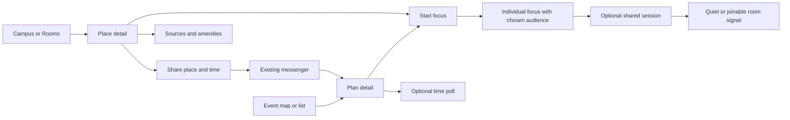

# Interaction research: focus and coordination

> **Research snapshot, 10 October 2026.** Kept for its evidence and reasoning. Where it conflicts with the [charter](../../../PROJECT-CHARTER.md) or the [focus sessions spec](../focus-sessions.md), those win.

Checked **10 October 2026**. This compares interaction patterns, not market share. No defensible fastest-growing ranking or local adoption ranking was established. Sources are official pages/help documentation and limited public browser flows; no paid membership or private/native session was tested.

## Evidence and useful patterns

Browser inspection covered Focusmate's public how-it-works page and expanded duration FAQ, Partiful's invitation landing page and entry into its create flow, and Luma's iOS help walkthrough. Partiful's initial editor showed incomplete/unlabeled controls in the observed state, so its completed creation flow is not claimed as tested. Forest and Focus Friend findings come from official descriptions, not hands-on native use.

| Reference | Supported interaction pattern | Translation to THD | What needs testing |
|---|---|---|---|
| [Focusmate](https://www.focusmate.com/how-it-works/) | Choose a session, greet/state goals, work, closing check-in; 25/50/75-minute options | Legible intent and completion, a few duration presets | Whether an in-person goal prompt helps; no camera requirement proposed |
| [Focusmate features](https://www.focusmate.com/features/) | Favorite partners and session preferences | Familiar people and clear quiet/joinable expectations | Whether reciprocal friends add value beyond a group link |
| [Forest](https://www.forestapp.cc/) | A growing object expresses focus progress; group focus links participants | Recognizable session state and calm visual feedback | Keep group participation independent rather than punishing everyone when one leaves |
| [Focus Friend](https://www.yourfocusfriend.com/) and [developer listing](https://play.google.com/store/apps/details?hl=en_US&id=com.underthing.focus.friend) | Companion, focus/break timers and decoration feedback | An original subtle mascot could make start/finish approachable | Whether it supports the map's purpose or distracts |
| [Partiful](https://partiful.com/) | Artwork-led invitation, date polling, RSVP and updates around a shared page | One coherent plan detail shared into existing chats, with one primary next action | Avoid requiring elaborate artwork for spontaneous study |
| [Luma iOS walkthrough](https://help.luma.com/p/luma-ios-app) | Follow calendars, inspect events, share links/posters/QR, RSVP; basic host title/location/time | Progressive organizer setup, source/venue detail, secondary sharing actions | Native help does not establish our web behavior; ticketing is not a requirement |
| [Doodle poll guide](https://help.doodle.com/en/articles/9457353-how-do-i-create-a-group-poll) | Availability collection and slot finalization | Same-slot quorum and host confirmation | Does it save work compared with usual chat? |
| [Kahoot joining guide](https://support.kahoot.com/hc/en-us/articles/360039890713-Kahoot-join-How-to-join-a-Kahoot-game) | Join a host's live session through PIN, direct link or QR; nickname and extra join requirements depend on host settings | Familiar lightweight join flow for a study group or recruitment event, without forcing a persistent profile | Maintainer reports frequent professor/student use; local adoption was not independently measured. Short codes need expiry, attempt limits and host control, not unguessable-link assumptions |
| [Discord identity model](https://support.discord.com/hc/en-us/articles/12620128861463-New-Usernames-Display-Names) | Unique username is separate from the prominent display name and contextual nicknames | Optional stable friend handle plus chosen display name; color is presentation, not identity | Handle complexity may be unnecessary for one-off sessions; never use a name/color as authorization or verified membership |

Google named Focus Friend its **US best app of 2025**. This dated editorial award is not evidence of fastest growth or best fit for THD in 2026. [Google Play announcement](https://blog.google/products-and-platforms/platforms/google-play/best-apps-games-2025/).

Doodle and Meetup are category references, not established local competitors. The maintainer does not observe common local use. WhatsApp/Instagram and, for some groups, Teams/Discord are the reported practical alternatives. Compare against those habits rather than requiring a community migration.

## Candidate advantage

Combine **a suitable place, a usable time window and understandable social intent**. Timers do not establish which THD room is suitable; invitations do not establish whether it stays lecture-free; favorites do not say whether company is welcome. This is a product hypothesis, not a worldwide novelty claim.

A useful pattern is a small initial commitment with richer controls when relevant. “Start focus” should not open a profile wizard. “Share this place” should not require an event brand, subscription or calendar integration. A recurring club gathering can have more structure than spontaneous study.

## Whole-app wireflow to prototype

Start within Campus / Rooms / Saved. A compact Campus layer control can separate rooms, study sessions and events/places. Preserve campus/time selection and equivalent list access. Avoid enabling every layer by default.

Place detail answers: which place; available for how long; relevant activity; what to do now. A focus mini-control persists within the app. Plan detail emphasizes the current state and next action: vote, confirm, join, follow organizer link or view a change. Calendar export is secondary.

## Design-system implications

- Place identity/campus label, availability window and source/opening status.
- Session mode/audience, progress, grace/expiry and compact session control.
- Activity marker and corresponding list row with distinct availability semantics.
- Plan summary, participant/quorum indicator, slot choices and change notice.
- Organizer/source identity, external-channel link and About/support hub.

Each needs EN/DE, long labels, touch/keyboard interaction, dark theme and reduced motion. Test state transitions before decorative animation. Explore an original rubber-duck motif for the author's hub if useful; do not reproduce the referenced game's character or assets.

## Next evidence

The maintainer has now selected individual room-linked focus and cohort discovery. The earlier three-concept comparison is superseded; [scope decision history](decision-history.md) records that change. Use these references to improve the selected flow, not to require a different product comparison before delivery.

Compare real tasks: find a room/start studying; join a willing classmate; arrange a session in usual chat versus a plan link; verify a club's last-minute change. Ask about the previous actual attempt before showing concepts. Observe completion, misunderstandings, time and voluntary reuse. Landing-page claims cannot establish attendance outcomes, local demand or willingness to pay. Test installed PWAs on phones before promising screen-awake behavior.

