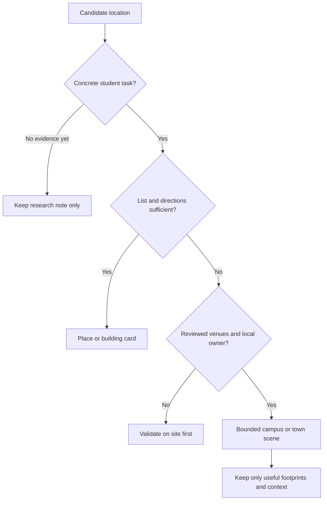

# Map coverage: what deserves to be mapped?

> **Research snapshot, 10 October 2026.** Kept for its evidence and reasoning. Where it conflicts with the [charter](../../../PROJECT-CHARTER.md) or the [focus sessions spec](../focus-sessions.md), those win.

Revised **10 October 2026**. The maintainer already edits GeoJSON by hand and considers that work manageable. An automated importer is **not** a project goal. The question is where a map helps enough to justify its content and upkeep.

## Recommended coverage

Keep one application with campus-scoped content. Start with Deggendorf and a small optional nearby-place layer. Offer other campuses as a room list, useful place links and directions first; commission a full scene only if local users demonstrate a navigation/discovery need. A campus selector does not require every campus to have identical features or geometry. Separate apps would duplicate distribution, accessibility, translations and maintenance without demonstrated benefit.

| Area | Evidence | Recommended initial representation | Gate for richer map |
|---|---|---|---|
| Deggendorf main campus | Existing working map and maintainer's firsthand experience | Preserve building-level room discovery; add reviewed entrances/amenities and restrained activity overlays | New marker must answer a real find/study/meet task |
| Nearby Deggendorf culture/food | Maintainer describes museum/library cluster and town festivals | Optional places layer with a few verified destinations and external event/menu links | Source owner, correct entrance, maintained hours/occurrence dates |
| European Campus Rottal-Inn, Pfarrkirchen | THD describes it as small/compact, with library and canteen | Campus room list plus essential directions/amenity links | A local walkthrough shows building/entrance confusion or several meaningful meeting destinations |
| Cham | THD lists Badstraße 21 and Dr.-Muggenthaler-Straße 11 and links building plans | Clearly addressed building/room list and official directions | Local validation establishes routes/entrances that a campus scene explains better than a list |
| Other research/technology sites | Existence alone does not demonstrate daily room-finding demand | Link only when an actual public event needs its venue | Identified student audience, usable room/access data and a local maintainer |

Sources: [ECRI description](https://www.th-deg.de/en/ecri-campus), [Cham site](https://www.th-deg.de/campus-cham), [official directions/building-plan index](https://th-deg.de/anfahrt). Campus size and student numbers alone do not prove map usefulness. No local walkthrough, complete building count or demand study was completed for ECRI/Cham. Do not promise a map or estimate required geometry from their names.

## What to include in the next Deggendorf inventory

Use this as a review sheet, not an instruction to draw everything:

| Candidate content | Include when | Keep out / unresolved |
|---|---|---|
| Teaching buildings | Building corresponds to eligible mapped rooms | Offices/labs do not automatically become available classrooms |
| Entrances and essential connecting paths | Needed to find a usable entrance or explain a short walk | Decorative road detail and inferred accessible routes |
| Library, canteen, coffee/food | Clear student benefit; menu/hours/source can be maintained | Every commercial venue in town |
| Museum, Handwerksmuseum, library and gallery/cultural venue | Correct venue/entrance is verified and links to existing services | Assumed four separate buildings; Stadtgalerie is described within Stadtmuseum |
| Campus festival/recruitment gathering | Organizer names venue and dates; marker expires | Permanent pin for an event that happened last semester |
| Fast Forest workshop or external event venue | Organizer deliberately publishes it for that event/audience | Private workspace or residence inferred from memory |
| City centre/Christmas market | Verified current occurrence and source; optional layer | Assumed annual dates carried forward without checking |
| Roads, water, trees and background buildings | Support orientation/readability in the bounded scene | Full-town geometry simply because GeoJSON makes it possible |

For each retained feature record: task served, campus/venue ID, source/date, public entrance, opening-status source, marker type, event expiry if relevant and maintenance owner. Record exact footprints only after this inventory identifies the destinations. Remove unhelpful GeoJSON context manually, as the maintainer already does.

The cultural cluster needs a venue/entrance check: [Stadtgalerie description within Stadtmuseum](https://stadtmuseum.deggendorf.de/veranstaltungen/event/kunst-duenger-grosse-ostbayerische-kunstausstellung) and [Kapuzinerstadl](https://www.deggendorf.de/kunst-und-kultur/kultureinrichtungen/kapuzinerstadl) show why institutions and physical buildings should not be conflated. Museums remain places, not teaching rooms. Unknown/stale opening hours should say check opening times; exhibition links can hand off to existing museum services.

## Decide representation before geometry

For ECRI/Cham, ask a few local students to find a room, library/canteen and gathering entrance with existing tools. Record wrong turns and whether the problem is between buildings, inside one building, or identifying a room code. An outdoor 2.5D map cannot solve all indoor floor/room problems. Use floor/directions links where that is sufficient.

## Technical reuse, kept proportional

`src/components/app/CampusMap/CampusMap.tsx` projects coordinates into local metres, rotates and extrudes SVG footprints. Reuse it per campus-sized scene. `campus-data.ts`/`context-data.ts` credit OSM data ported from Claude Design commit `de229b71`; no acquisition generator is checked in. The maintainer supplies the practical preparation context: manually trim GeoJSON rather than automate a few datasets.

Before loading a new scene, review these real constraints:

- Polygon handling assumes closed rings; holes and all but the first MultiPolygon part are ignored. Normalize selected data or improve support where the chosen dataset requires it.
- Deggendorf-specific paint order (C/HS, G/E, GH/ITC2), GH label offset and DONAU text must become scene-specific if reused elsewhere.
- `src/domain/campusAvailability.ts` has campus-specific room mappings. Campus/building/upstream room identities must avoid same-letter collisions.
- Context currently uses a type cast; validate selected geographic input and attribution. Preserve dataset source/license and correction notes.
- Load only the selected scene and its relevant place data. New coverage must not force every student to download every town's geometry.

These are bounded adaptation tasks, not a prerequisite to build a generalized GIS system. No importer, new map or campus dataset is implemented in this phase.
