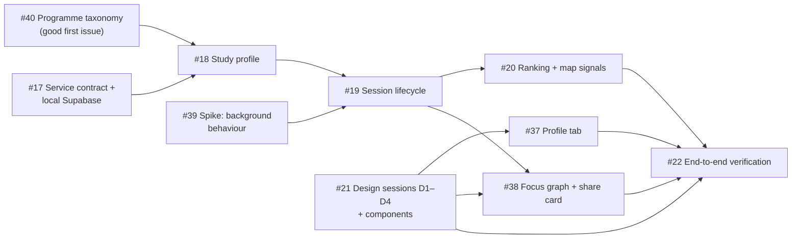

# Roadmap

The roadmap is **outcome-ordered, not date-driven**. Each phase is a GitHub
milestone with one epic; epics own native sub-issues. Live status is on the
[project board](https://github.com/users/arudaev/projects/8).

| Phase | Milestone | Epic | Outcome |
|---|---|---|---|
| Foundation | [M0 — Foundation](https://github.com/arudaev/THD-Room-Finder/milestone/2) | [#30](https://github.com/arudaev/THD-Room-Finder/issues/30) | Design system, docs, issue taxonomy, board and automation ready for contributors |
| Phase 1 | [M1 — Focus sessions](https://github.com/arudaev/THD-Room-Finder/milestone/1) | [#16](https://github.com/arudaev/THD-Room-Finder/issues/16) | Focus in a free room, privately or with your batch |
| Phase 2 | [M2 — Group focus & profiles](https://github.com/arudaev/THD-Room-Finder/milestone/3) | [#23](https://github.com/arudaev/THD-Room-Finder/issues/23) | Study together; recognisable profiles |
| Phase 2 | [M3 — Organizations & gatherings](https://github.com/arudaev/THD-Room-Finder/milestone/4) | [#24](https://github.com/arudaev/THD-Room-Finder/issues/24) | Verified organizations announce gatherings and study sessions |
| Phase 3 | [M4 — City layer](https://github.com/arudaev/THD-Room-Finder/milestone/5) | [#25](https://github.com/arudaev/THD-Room-Finder/issues/25) | Deggendorf events, festivals and museums on the map |

## M0 — Foundation

| Issue | Deliverable | Delivered by |
|---|---|---|
| [#31](https://github.com/arudaev/THD-Room-Finder/issues/31) | Claude Design system evolved, focus layer added, mirrored in `design/` | Design-system PR |
| [#32](https://github.com/arudaev/THD-Room-Finder/issues/32) | Focus-first charter, ADR 0002 | Docs PR |
| [#33](https://github.com/arudaev/THD-Room-Finder/issues/33) | Documentation in `docs/` | Docs PR |
| [#34](https://github.com/arudaev/THD-Room-Finder/issues/34) | Issue forms, labels, PR conventions, `/take`, roll-up | Delivery PR |
| [#35](https://github.com/arudaev/THD-Room-Finder/issues/35) | Board fields, views, workflows | Settings + docs |
| [#36](https://github.com/arudaev/THD-Room-Finder/issues/36) | Rulesets, merge policy, branch cleanup | Settings |
| [#26](https://github.com/arudaev/THD-Room-Finder/issues/26) | Token-based board sync | Maintainer creates `PROJECTS_TOKEN` |

## M1 — Focus sessions

**Parallel tracks.** Design (#21) starts immediately and does not wait for the
backend. The taxonomy (#40) and the background spike (#39) are independent and
ideal first contributions. The backend chain #17 → #18 → #19 → #20 is
sequential and suits a [native PR stack](../contributing/workflow.md#stacked-pull-requests).

**Suggested stack for the backend chain:**

| Layer | Branch | Issue |
|---|---|---|
| 1 | `feature/17-focus-service-local` | #17: schema, RLS, RPCs, seeds (local only) |
| 2 | `feature/18-study-profile` | #18: sign-in, profile setup, batch derivation |
| 3 | `feature/19-focus-lifecycle` | #19: start, renew, end, expiry, local history |
| 4 | `feature/20-focus-ranking` | #20: buckets, badges, map markers |

## M2–M4

Epics carry candidate stories; they are decomposed into sub-issues when the
previous milestone is nearly done, so the backlog stays honest. See
[later phases](later-phases.md).

## How the roadmap changes

A new idea becomes a [discussion](https://github.com/arudaev/THD-Room-Finder/discussions)
or an issue with `needs-triage`. The maintainer either places it in a milestone
(with Phase, Priority and Size on the board) or closes it as not planned with
a reason. Changing a phase's scope updates the [charter](../../PROJECT-CHARTER.md)
in the same PR.
