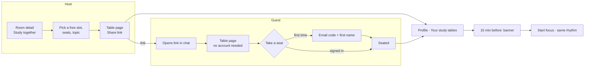

# Study tables

Phase 2 · M2. Plan a study table in a free room for later, share one link, and
whoever opens it takes a seat. Decisions: [ADR 0007](../architecture/adr/0007-study-tables.md).
Design brief: [`design/brief/09-study-tables.md`](../../design/brief/09-study-tables.md).

## The idea in one paragraph

A **study table** is a round table in a lab session: a room, a time and a
few seats. You set one in a free room ("C001 · today 14:00 · 6 seats"), send
the link to your group chat, and people take a seat or say maybe. At the time
everyone taps **Start focus** and studies in the same rhythm. That is the whole
feature: no calendar, no friends list, no feed, no chat. The app never books
the room and says so.

## Principles

1. **One object, one link.** A table is the only new thing. The link is the
   invite; there is nothing else to manage.
2. **Start from a room, not a calendar.** You set a table where you already
   are in the app: a free room. Times come from that room's free windows, so
   a table is always in a room that is actually free.
3. **People, not social graphs.** No friends, follows or search. You see the
   tables you set and the ones you sat down at.
4. **Accounts only when needed.** Anyone can open a link. Taking a seat needs
   the email code and a first name, nothing else.
5. **Same rhythm as focus.** At the time a table becomes an ordinary focus
   session for everyone at it, in step.
6. **Design system first.** Every screen uses the components listed below;
   nothing is styled ad hoc.

## Words

| Word | Means | Never say |
|---|---|---|
| Study table | The planned group session. Always "study table" in the app, never just "table", so it can't read as a restaurant | Event, meeting, booking, reservation |
| Study together | The action that starts one, on room detail | Study together, book, reserve, schedule |
| Invite people | The button that creates it in the sheet | Set table, create |
| Take a seat | Reply yes | RSVP, accept |
| Maybe · Can't make it | The other two replies | Decline |
| Host | Who set the table | Owner, admin |
| Table link | `thd-room-finder.vercel.app/t/mossy-lagoon-42` | Code, token |
| Just me | A table with one seat: a planned solo session, no link | Private event |

German: **Lerntisch** (never just Tisch), **Zusammen lernen**, **Leute einladen**,
Platz nehmen, Vielleicht, Kann nicht, Gastgeber·in, Lerntisch-Link, Nur ich.

## Who does what



## User stories

### Setting a table

| # | As a student I want to… | So that… | Acceptance |
|---|---|---|---|
| T1 | set a table from a room I am looking at | the room is one I know is free | **Study together** sits under Start focus on room detail. The sheet opens with that room fixed |
| T2 | pick a time from the room's free slots | I can't pick a time when a lecture is on | Day chips (Today, Tomorrow, then weekday and date to 2 weeks; closed days are left out). For the day, slot chips from the room's free windows, cut to the lecture grid (08:00, 09:45, 11:30, 13:15, 15:00, 16:45, 18:30) and opening hours. When the first day has no slot left, the sheet opens on the next day that has one |
| T3 | choose how many seats | it feels like a real table | Seat chips 2 · 4 · 6 · 8 · 12, default 4. **Just me** makes it a planned solo session with no link. Under the chips: "More people? Register your group", which opens the [registry](organizations.md) request in Profile |
| T4 | say what we study, optionally | people know what the table is for | One line, up to 40 characters, placeholder "What are you studying?" |
| T5 | keep the length simple | there is no form to fill | Length = the slot, capped at 3 h; rhythm = my focus rhythm, shown as one line I can change |

### Inviting

| # | As a host I want to… | So that… | Acceptance |
|---|---|---|---|
| T6 | share the table link | my group chat gets it in one tap | After Set, the table page opens with the share sheet. The link reads like `mossy-lagoon-42` |
| T7 | a preview in the chat | people see what it is before tapping | Preview: "Algorithms · Thu 22 Oct, 13:15 · C001 · 3 of 6 seats". No names |
| T8 | also email the link | someone outside the chat gets it | **Email** opens the mail app with the text and link; the app sends nothing |

### Joining

| # | As a guest I want to… | So that… | Acceptance |
|---|---|---|---|
| T9 | see the table without an account | I decide before signing up | Table page with the seat ring, room, time, rhythm and replies |
| T10 | take a seat in two steps | joining is quick | **Take a seat** → email → code → first name → seated. The page never reloads into something else |
| T11 | say maybe or can't | the host can plan | Maybe holds no seat; Can't removes me from the table |
| T12 | see who sits there | I know who to expect | First names, the host's too; someone without a first name counts as "1 more". There is no name switch: the first name is asked for tables |
| T13 | know when the table is full | I don't turn up for nothing | Full tables show "Full · 6 of 6"; Maybe stays possible |

### Before and at the time

| # | As someone at a table I want to… | So that… | Acceptance |
|---|---|---|---|
| T14 | find my tables again | I don't lose the link | Profile → **Your study tables**, next first; tables drop off when they end |
| T15 | a reminder | I leave on time | 15 minutes before: a banner in the app on any tab; Android notification in a later step |
| T16 | start focus at the table | we study in step | From 15 minutes before: **Start focus in C001**, anchored at the table's start, so breaks line up |
| T17 | know if the room stops being free | we don't walk into a lecture | The table page shows "A lecture is now scheduled here" and offers to move to a free room at the same time |
| T18 | (host) change or cancel | people aren't misled | Change room or time, or **Cancel study table**. Guests see **Changed** or **Cancelled** in Your study tables and on the page |

### Accounts and install

| # | As a new student I want to… | So that… | Acceptance |
|---|---|---|---|
| T19 | an account only when I take a seat | the first visit is free of friction | Email code + first name; programme and batch stay optional and can be added later in Profile |
| T20 | install the app after joining | I come back | After the first seat, a one-time hint "Add to home screen" (iOS: share sheet steps, Android: install prompt) |

## Where things live

| Place | What appears | Who sees it |
|---|---|---|
| Room detail | **Study together** under Start focus. If I have a table in this room today: a table row "Your study table · 13:15" | Everyone; the row only for me |
| Room list and map | A small seat marker on rooms where I have a table today | Only me |
| Profile | **Your study tables** above Saved rooms; empty state invites to set one from a room | Me |
| Any tab | Reminder banner 15 minutes before | Me |
| `/t/<link>` | Table page | Anyone with the link |

There is no new tab, no table list for strangers and no search.

## Phones, tablets and desktops

The table follows the app's layouts; nothing about it is phone-only.

| Window | Navigation | Study together | Table page | Your study tables |
|---|---|---|---|---|
| Phone, portrait | Bottom bar | Bottom sheet | One column: ring on top, details, actions in thumb reach | Profile section |
| Phone, landscape | Rail | Dialog, slots and seats side by side | Ring left, details and actions right | Profile, two columns |
| Tablet, portrait | Bottom bar | Bottom sheet, wider chips | One column, ring at 168 | Profile section |
| Tablet, landscape, desktop | Rail (tablet) or drawer (≥ 840 px) | Centred dialog, 560 px | Ring left at 240, details and actions right, max 960 px | Profile: tables in a grid of cards |

On wide windows the reminder banner sits at the bottom of the content area,
not under the rail or drawer.

## Screens and states

### Study together (sheet)

```
┌────────────────────────────────┐
│ Study together in C001         │
│ Today  Tomorrow  Thu  Fri  …   │  day chips
│ 13:15  15:00  16:45            │  free slots that day
│ Seats  2 [4] 6 8 12  Just me   │
│ What are you studying?  ____   │
│ Pomodoro · 25/5 · Change       │
│ [ Invite people ]              │
│ An invite, not a room booking. │
└────────────────────────────────┘
```

| State | Shows |
|---|---|
| Loading the day | Slot chips as skeletons |
| No free slot that day | "No free slot on Thursday" and the next day with one |
| Closed day | Left out of the day chips |
| Signed out | **Invite people** asks for the email code first, then sets the table |
| Error | Inline line above the button; nothing lost |

### Table page

```
┌────────────────────────────────┐
│ ‹  Study table                 │
│        ●  ●                    │
│     ●  [C001]  ○               │  seat ring: taken / empty
│        ○  ○                    │
│ Algorithms                     │
│ Thu 22 Oct · 13:15–14:45       │
│ C001 · free then · Pomodoro    │
│ Max, Lena and 1 more · 1 maybe │
│ [ Take a seat ]  Maybe  Can't  │
│ Share · Email                  │
│ Anyone with this link can see  │
│ it. An invite, not a booking.  │
└────────────────────────────────┘
```

| State | Shows |
|---|---|
| Guest, signed out | Ring, details, **Take a seat** |
| Seated | Ring with my seat highlighted, "You're at this table", Maybe / Can't |
| Host | "Your table", Share and Email first, Change and Cancel table |
| Full | "Full · 6 of 6"; Take a seat disabled, Maybe possible |
| Starting soon / now | **Start focus in C001** in focus violet |
| Lecture appeared | Warning line and **Move to a free room** (host) |
| Changed | Chip **Changed** |
| Cancelled | Ring greyed, "Cancelled by the host" |
| Over | "This table has ended" |
| Unknown link | "This table isn't here any more" and a link to the map |

### Your study tables (Profile)

One row per table: topic or "Study table", day and time, room, seat
count and a chip (Now, Soon, Changed, Maybe, Cancelled). Tap opens the page.

## Components (design system)

| Component | New / extended | Purpose |
|---|---|---|
| `SeatRing` | New | Round table with N seats: taken, mine, empty; room code in the middle; greys out when cancelled |
| `StudyTableCard` | New | The table page's main card: ring, topic, when, where, who |
| `SlotChips` | New | Day chips and free-slot chips for one room |
| `ReplyBar` | New | Take a seat · Maybe · Can't, with the full and seated states |
| `TableRow` | New | One table in Your study tables, with its chip |
| `TableBanner` | New | The 15-minute reminder |
| `Chip`, `SegmentedControl`, `Sheet`, `Switch`, `Button` | Reused | — |

Colours: tables use the focus violet (`--md-focus`); free slots use teal;
nothing new in the palette. Ochre stays reserved for the city layer.

## Rules

| Rule | Value |
|---|---|
| When | Today up to 14 days ahead, only inside opening hours |
| Length | The chosen slot, 25 minutes to 3 hours |
| Seats | 2, 4, 6, 8 or 12; Just me = 1. Larger groups register as an organization |
| Tables you host | Up to 5 upcoming |
| Topic | Optional, up to 40 characters |
| Link | Two words and two digits, e.g. `mossy-lagoon-42`: a describing word and a thing, each from a list of 512 short plain English words, then 10–99 |
| Kept | Until 24 hours after the end, then deleted |

## Privacy

- The server keeps the table (host, room, time, seats, topic, link) and each
  reply (who, which). No email with a table.
- Anyone with the link can read the table; previews carry no names.
- No list of tables for strangers, no search, no friend graph.
- Everything goes 24 hours after the table ends; deleting your account
  removes your tables and replies at once.

## Out of scope

Friends and follows, chat, recurring tables, calendar export, tables visible
to a whole batch, tables over 12 seats. Gatherings for 20, 60 or 120 people
are an organization feature (M3, [organizations](organizations.md)).
