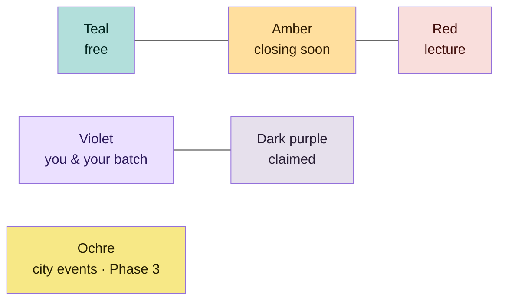

# Vision

## From exam utility to daily habit

| | Today (v2.2) | Phase 1 | Phases 2–3 |
|---|---|---|---|
| Question answered | Where is a free room, for how long? | Where do I focus today, and who from my batch is around? | What is happening on campus and in town? |
| When people open it | Exam season | Every study day | Every day, including evenings and weekends |
| Social layer | None | Anonymous claims, batch invitations | Groups, profiles, organizations, city events |
| Accounts | None | Optional study profile | Profiles, organization accounts |

## Principles

1. **Answer first.** Lead with the one fact a student needs: how long a room
   stays free, where the batch is, what is on tonight. Controls stay tucked
   away; the list and map are the product.
2. **The schedule is the truth.** THabella decides whether a room is in use
   for teaching. Social signals add to it and never override it.
3. **Private by default.** Sharing is a deliberate, reversible choice with
   plain-language consequences.
4. **Works without an account.** Every feature that can work locally does.
5. **One codebase, two languages, every screen size.** Web PWA and Android
   from the same React app; English UI with live German; phone, tablet and
   desktop layouts.
6. **Cheap to run.** A student project cannot carry a large cloud bill:
   bounded requests, local-first features, cost ceilings before launch.
7. **Open source, open process.** GPL-3.0, public issues and board, a
   contributor path from `/take` to merged PR.

## Colour as language

The app speaks in four status colours plus two focus colours. The
[focus sessions spec](focus-sessions.md#colour-semantics) defines them; the
[design system](../../design/README.md) owns the tokens.

## What success looks like

| Signal | Phase 1 target (pilot) |
|---|---|
| Weekly active users outside exam season | Stable or growing, not collapsing after exams |
| Sessions started per active user per week | ≥ 2 |
| Share of sessions made public | Tracked, no target: privacy by default is intentional |
| Cost per month | Within the budget set at hosted activation |

Measured with the existing privacy-friendly Vercel Analytics and aggregate
service counters, never per-student tracking.
